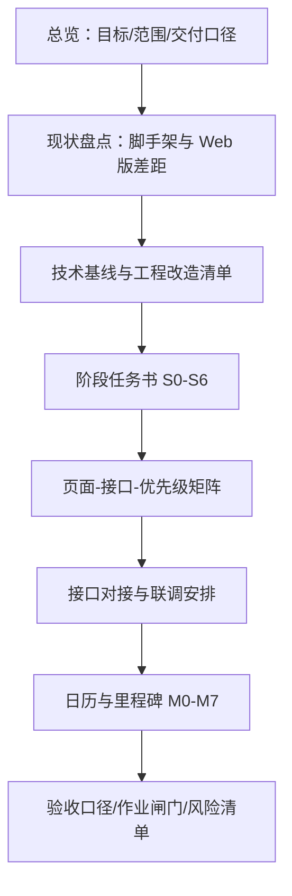

## 产品概述
为「小兔鲜」商城产出一份可直接执行的中文学习与开发计划文档（落盘 `./idoc`），指导从零用微信小程序原生技术复刻已有 React Web 版商城，并在过程中系统掌握小程序开发，为后续 uni-app 迁移打基础。本次只交付计划文档，不改动任何代码。

## 核心交付内容
- **分阶段路线**：环境搭建 → 基础语法 → 核心页面 → 业务闭环 → 进阶与发布，每阶段有明确主题与准入条件。
- **模块开发顺序与优先级**：以 Web 版现有模块（首页、分类、详情、购物车、结算、支付、会员中心、地址）为主干，补充小程序文档独有的搜索、热门推荐、订单物流/确认收货等能力，标注 P0/P1/P2。
- **阶段任务书**：每阶段给出学习目标、对应小程序知识点、要实现的页面与文件、可交付成果、可勾选验收标准、预计工时。
- **接口对接与联调安排**：请求封装、`source-client: miniapp`、token 与 401 处理、本地/服务端购物车合并、模拟支付，以及逐接口核对与联调节奏。
- **时间节点与里程碑**：按每天 4-5 小时排到日，含缓冲；M0–M7 可演示检查点。
- **风险与注意事项**：域名白名单、主包 2MB 与分包、自定义导航栏适配、微信支付资质、wx.login 依赖后端、富文本与 rpx、页面栈限制等，并给出预案。

## 已确认约束
- 每天 4-5 小时，3-4 周完成。
- 技术栈为 JavaScript + WebView 渲染（放弃现有 TS + Skyline 模板）。
- 登录先用账号密码，支付先用模拟支付，最后阶段再补 wx.login 与微信支付。
- 范围为 Web 版模块 + 搜索，尽量覆盖接口文档能力。


## 技术栈选择
- **运行环境**：微信小程序原生（JavaScript + WXML + WXSS + JSON），基础库 2.32.3，WebView 渲染器。
- **工程改造基线**（文档中作为 S0 的施工清单，不在本次执行）：关闭 Skyline（`app.json` 移除 `rendererOptions` 与 `componentFramework`；`project.config.json` 关闭 `skylineRenderEnable`、移除 `typescript` 编译插件），`.ts` 全量改 `.js`，移除 `tsconfig.json` 与 `typings/`；保留 Sass 编译插件与 `rpx` 适配。
- **不引入**第三方 UI 库与 npm 依赖，组件全部手写，保证学习密度与包体积可控。
- **与既有资产的关系**：`F:/Web/react-rabbit/src/apis`、`src/pages`、`src/store/slices` 作为「需求文档 + 接口参考 + 业务字段台账」；`docs/03-roadmap.md` 的阶段/闸门组织方式作为文档体例参考。

## 实施方案
**方法**：以「七阶段 + 作业闸门 + 里程碑」组织，把小程序知识点嵌入真实页面开发，而不是先学后做。文档采用「总览 → 基线 → 阶段任务书 → 矩阵 → 联调 → 日历 → 风险」的施工图结构，保证可逐条勾选验收。

**阶段划分与优先级**
| 阶段 | 主题 | 主要产出 | 优先级 |
| --- | --- | --- | --- |
| S0 | 环境与工程基线 | JS+WebView 改造、目录分层、request 封装、tabBar 骨架 | 前置 |
| S1 | 小程序基础语法 | 首页静态版（WXML/WXSS/事件/setData/列表渲染） | 前置 |
| S2 | 首页 + 分类 | 轮播、前台分类、商品流、分类页、触底加载 | P0 |
| S3 | 详情 + SKU + 搜索 | SKU 弹层组件、富文本、图片预览、搜索与提示语 | P0/P1 |
| S4 | 登录 + 购物车 | token 持久化、本地购物车、合并、勾选/数量/角标 | P0 |
| S5 | 结算 + 订单 + 支付 + 地址 | 订单链路、倒计时、tab 分页、模拟支付、地址 CRUD | P1 |
| S6 | 会员中心 + 进阶 | 个人中心、订单详情/物流/确认收货、wx.login、微信支付、分包与发布准备 | P1/P2 |

**关键设计决策**
1. **状态管理不照搬 Redux**：小程序用 `app.globalData` + 轻量事件总线（或单例 store）承载 user/cart，页面 `onShow` 拉取与订阅刷新；避免引入重状态库，降低学习成本。
2. **网络层统一封装**：Promise 化 `wx.request`，统一注入 `source-client: miniapp` 与 `Authorization`，统一处理 `code/msg/result`、401 单次跳登录（防止并发重复跳转）、loading 与错误提示、超时。
3. **接口不臆造**：文档明确要求「以接口文档为准，以 React 版 `src/apis` 为起点逐条核对 path/入参/返回」，并把已实测字段约定（`isDefault === 0`、`realPay` 为行小计、`quantity`、`countdown` 秒、`isEffective` 过滤、库存 10004）写入台账，避免小程序端重踩。
4. **支付双轨**：S5 用「模拟支付-内测版」跑通订单状态流转；S6 再讲 `wx.requestPayment` 所需商户号、签名由后端下发、真机调试路径，作为进阶而非阻塞项。
5. **性能与体积**：主包只放首页/分类/购物车/我的四个 tabBar 页与公共组件，详情/结算/订单/地址/搜索进分包；列表分页 + `setData` 增量更新；定时器在 `onUnload` 清理；图片走 CDN 并配置 downloadFile 域名。

## 实施要点
- 文档中所有工时按 4-5h/天折算，总周期 20 个工作日 + 2-3 天缓冲，日期从 2026-11-25 起排至 2026-12-22。
- 每阶段设「作业闸门」（可交付物 + 3 问自检），未通过不进入下一阶段，防止「页面能跑但讲不出为什么」。
- 验收标准一律写成可勾选清单，并区分「功能对齐」「学习达标」「质量红线」三层口径。
- 接口联调按「单接口冒烟 → 页面级联调 → 跨页链路 → 异常与边界」四步推进，明确开发者工具「不校验合法域名」只用于开发期。
- 本次不修改 `miniprogram/` 下任何文件、不改 `app.json`/`project.config.json`/`package.json`；仅新增 `idoc` 文档。

## 文档结构（交付物）


## 目录结构
```
f:/WeChatProjects/miniprogram-rabbit/
└── idoc/
    └── miniprogram-dev-plan.md   # [NEW] 主计划文档：总览、现状盘点、技术基线、S0-S6 阶段任务书、
                                  # 页面-接口-优先级矩阵、联调安排、日历里程碑、验收口径、风险与附录
```
文档内同时给出未来代码落地建议目录（仅描述，不创建）：
```
miniprogram/
├── app.js / app.json / app.scss        # 全局配置、tabBar、全局样式变量
├── api/                                # home/category/detail/cart/user/order/address/search/pay
├── utils/                              # request.js、storage.js、format.js、auth.js
├── store/                              # user.js、cart.js（轻量单例 + 事件订阅）
├── components/                         # goods-item、sku-popup、nav-bar、empty、count-down、price
└── pages/                              # home、category、detail、cart、login、checkout、order、pay、member、address、search
```

