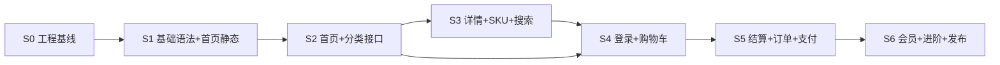

# 小兔鲜商城 · 微信小程序原生开发学习与交付计划

> 版本 v1.0 ｜ 制定日期 2026-11-24 ｜ 计划周期 2026-11-25 ~ 2026-12-22（20 个开发日 + 3 天缓冲）
> 技术基线：微信小程序原生（JavaScript + WXML + WXSS + JSON）｜ WebView 渲染 ｜ Sass ｜ 基础库 2.32.3
> 需求与接口参照：`F:/Web/react-rabbit`（React Web 版）＋《小兔鲜儿 - 小程序版》Apifox 文档
> 目标：**一边交付可运行的小程序商城，一边把小程序知识点长在真实业务上**，并为后续 uni-app 迁移预留结构。

---

## 0. 先读这一页

### 0.1 六个问题的答案在哪

| 你的要求 | 对应章节 | 一句话结论 |
| --- | --- | --- |
| 分阶段学习与开发路线 | §5（S0–S6 任务书） | 七阶段：工程基线 → 基础语法 → 首页分类 → 详情搜索 → 登录购物车 → 交易闭环 → 会员中心与发布 |
| 模块开发顺序与优先级 | §4（页面-接口-优先级矩阵） | P0 先跑「逛-选-加购-下单」主动线，P1 补结算/支付/地址/搜索，P2 补热门推荐/物流/再次购买 |
| 每阶段目标/知识点/交付/验收 | §5 每阶段六件套 | 学习目标 → 知识点表 → 施工步骤 → 交付物 → 验收清单 → 作业闸门 |
| 接口对接与联调 | §6 | 先封装统一 request，再按「冒烟 → 页面 → 链路 → 异常」四步联调；路径以 Apifox 为准，Web 版 `src/apis` 只作起点 |
| 时间节点与里程碑 | §7 | 20 天排到日，M0–M7 每 2–4 天一个可演示节点，留 3 天缓冲 |
| 风险与注意事项 | §9 | 最大风险不是语法，而是「接口字段差异 + 域名/支付资质 + 抄代码学不会」 |

### 0.2 三条硬纪律

1. **接口文档是唯一契约。** React 版的 `src/apis` 只能当起点；小程序文档要求额外 header `source-client: miniapp`，且部分接口（搜索、微信登录、模拟支付、物流、确认收货）Web 版根本没有。**不许凭记忆写路径和字段**。
2. **每个页面用「三遍法」。** ① 读 React 版页面，列出「数据从哪来、有哪些交互、有哪些状态」；② 关掉 React 版，用小程序写；③ 打开 React 版 + 真机逐条对照，把差异记进 `idoc/notes/`。第 ③ 步才是学到东西的地方。
3. **每阶段过闸门再前进。** 交付物不全或三问答不出，就停在当前阶段补，不靠「先往下写着看」蒙混。小程序的坑是叠加的：`setData` 没学透，后面购物车必然出「数据变了页面不动」。

### 0.3 本次交付边界

- 本文件只是**计划**，不修改 `miniprogram/` 下任何代码、配置和依赖。
- S0 的工程改造（TS → JS、关闭 Skyline）在计划确认后单独执行，执行前先打 Git 基线。
- 文档中的接口路径凡标「待核对」的，联调第一天必须以 Apifox 的「运行」结果为准，并回填到 §6.6 的核对表。

---

## 1. 背景、资产与范围

### 1.1 三份资产各自的角色

| 资产 | 位置 | 在本项目中的角色 | 使用方式 |
| --- | --- | --- | --- |
| React Web 版商城 | `F:/Web/react-rabbit` | **需求文档 + 交互参照 + 业务字段台账** | 逐页对照功能与状态；字段坑直接继承（见 §4.4） |
| 小程序接口文档 | Apifox《小兔鲜儿 - 小程序版》 | **唯一接口契约** | 路径/入参/返回/错误码以它为准；小程序专属能力只看它 |
| 小程序脚手架 | `f:/WeChatProjects/miniprogram-rabbit` | **代码起点** | 当前是 TS+Sass+Skyline 模板，S0 先改造成 JS+WebView |

> React 版自带的 `docs/`（六阶段任务书、验收表、作业闸门）证明了「同一业务、两套框架」这种学习方式可行。本计划沿用它的**组织体例**（阶段 + 闸门 + 里程碑 + 可勾选验收），但知识点全部换成小程序。

### 1.2 范围：做什么、不做什么

**做什么（按优先级）**

| 优先级 | 模块 | 具体能力 |
| --- | --- | --- |
| P0 | 首页 | 轮播、前台分类、新鲜好物、人气推荐、商品流、猜你喜欢 |
| P0 | 分类 | 一级分类（轮播 + 子分类 + 推荐商品）、二级列表（排序 + 分页） |
| P0 | 商品详情 | 图片画廊与预览、价格/服务、SKU 规格选择、库存联动、加入购物车、图文详情、热榜推荐 |
| P0 | 购物车 | 游客本地车、登录服务端车、合并、勾选/全选、数量增减、删除、失效商品、合计、角标 |
| P0 | 登录 | 账号密码登录、token 持久化、401 单次跳登录、登录后回跳 |
| P0 | 订单 | 订单列表（状态 tab + 分页 + 倒计时）、取消订单 |
| P1 | 结算 | 结算页、提交订单、订单详情、地址选择、配送时间 |
| P1 | 支付 | 支付页、倒计时、**模拟支付（内测版）**、支付结果页、订单状态刷新 |
| P1 | 地址 | 地址列表、新增/编辑（省市区 picker）、删除、设默认、结算页选择地址 |
| P1 | 搜索 | 搜索历史、提示语、结果列表、排序/筛选 |
| P1 | 会员中心 | 我的页面、登录保护、订单入口、地址入口 |
| P2 | 会员进阶 | 个人资料、头像昵称、订单操作（确认收货/删除/物流）、再次购买/立即购买 |
| P2 | 热门推荐频道 | 特惠推荐、爆款推荐、一站买全、新鲜好物（独立频道页） |
| P2 | 进阶 | `wx.login` 换 token、`wx.requestPayment` 微信支付、订阅消息、发布上线 |

**不做什么（明确降级，避免范围失控）**

| 不做 | 原因 | 替代 |
| --- | --- | --- |
| 真实微信支付 | 需商户号、证书、后端签名，个人主体通常不具备 | 用「模拟支付-内测版」跑通状态流转；S6 只做接入讲解与代码骨架 |
| 真实 `wx.login` 登录 | 需后端用 code 换 openid/session | S6 选做；主线用账号密码登录 |
| 第三方 UI 库（Vant Weapp 等） | 学习密度低、包体积大、样式黑盒 | 全部手写组件，样式变量统一 |
| 自建 Mock 服务 | 接口可用，收益低 | 仅首页留 `USE_MOCK` 开关，接口挂掉时不阻塞学习 |
| 支付回调页 | 小程序支付走 `wx.requestPayment` 回调，没有 Web 的站外回跳 | 支付后轮询/手动刷新订单详情 |
| 同类推荐（已废弃） | 文档标注废弃 | 用热榜/猜你喜欢替代 |

### 1.3 「做完了」的三层口径

| 层级 | 口径 | 判定方式 |
| --- | --- | --- |
| L1 结构对齐 | 页面/组件/接口/store 分层清晰；页面不直接写 `wx.request`；公共组件被至少两处复用 | 目录走查 + 全局搜索 `wx.request` 只出现在 `utils/request.js` |
| L2 功能对齐 | 五条用户旅程（§8.2）全部走通，含加载态、空态、错误态 | 真机 + 开发者工具逐条录屏/截图 |
| L3 质量红线 | 无控制台报错、无 401 风暴、无重复下单、主包 ≤ 2MB、切页无定时器泄漏 | 验收清单 + 体验评分 + Network 面板 |

---

## 2. 现状盘点与差距

### 2.1 小程序工作区现状

```
f:/WeChatProjects/miniprogram-rabbit/
├── package.json                  # 只有 miniprogram-api-typings，无脚本
├── project.config.json           # useCompilerPlugins=[typescript,sass]，skylineRenderEnable=true
├── project.private.config.json   # 个人配置（应 gitignore）
├── tsconfig.json                 # strict，include ./**/*.ts
├── typings/                      # 10 个 .d.ts
└── miniprogram/
    ├── app.json                  # 仅 pages/index、pages/logs；navigationStyle=custom；Skyline 配置
    ├── app.ts / app.scss
    ├── components/navigation-bar/  # 模板自定义导航栏
    ├── pages/index/ pages/logs/    # Hello World 模板
    └── utils/util.ts
```

**结论：这是一个未开工的官方模板。** 没有 tabBar、没有业务页面、没有网络层，且技术栈与目标（JS + WebView）相反。

### 2.2 React Web 版模块盘点（作为对照物）

| 模块 | Web 版实现 | 关键行为（小程序要还原的） |
| --- | --- | --- |
| 首页 | `pages/home` + 5 个子组件 | 分类菜单（含悬浮推荐层）、轮播、新鲜好物、人气推荐、商品流；数据来自 5 个接口 |
| 分类 | `pages/category`、`pages/sub-category` | 一级：面包屑 + 轮播 + 全部子分类 + 每个子分类的推荐商品；二级：3 个排序 tab + 触底分页 |
| 详情 | `pages/detail` + ImageView/SkuSelector/DetailHot | 主图预览、销量评价收藏品牌、SKU 弹层（笛卡尔积）、数量、加购前查实时库存、图文详情、24h/周热榜 |
| 购物车 | `pages/cart` + 2 个子组件 | 游客本地车 / 登录服务端车；勾选、全选、数量防抖、删除、失效商品置底与批量清空、合计、去结算 |
| 登录 | `pages/login` | 账号密码 + 协议勾选 + 防重复提交 + 登录后合并购物车 + 回到来源页 |
| 结算/支付 | `pages/checkout`、`pages/pay` | 预付订单三块数据、地址切换弹窗、配送时间、提交订单、倒计时、支付、结果页 |
| 会员中心 | `pages/member` + UserInfo/UserOrder/OrderDetail/UserAddress/CancelOrderModal | 登录保护、个人资料、猜你喜欢、7 个订单 tab + 分页 + 多倒计时、订单详情、取消订单、地址 CRUD |
| 状态 | Redux Toolkit（cart/user/navList） | 购物车本地/服务端双轨、跨 slice 的「登录合并、登出清空」 |

### 2.3 Web → 小程序的关键差异（先认清，少返工）

| 维度 | React Web | 微信小程序 | 影响 |
| --- | --- | --- | --- |
| 运行环境 | 浏览器 DOM | 逻辑层 JS + 视图层 WebView，**无 DOM** | 不能操作节点；一切靠 `setData` 驱动视图 |
| 更新视图 | `setState` 触发重渲染 | `this.setData()` 局部更新；有 1MB/次限制 | 大列表要分页、增量更新，不能整表重塞 |
| 路由 | React Router，URL 可分享 | 页面栈 + `navigateTo/redirectTo/switchTab/reLaunch` | 传参只能用 query；tabBar 页必须 `switchTab`；栈深 ≤ 10 |
| 样式 | 全局 CSS + scoped | WXSS，单位 `rpx`，组件样式默认隔离 | 设计稿按 750 宽换算；不能用的选择器要避开 |
| 组件 | 函数组件 + props | 自定义组件 `Component` + `properties` + `triggerEvent` | 事件名、属性观察者、`styleIsolation` 是新知识 |
| 状态 | Redux / Context | `app.globalData` + 单例 + 订阅（本计划） | 不引入重状态库，页面 `onShow` 兜底刷新 |
| 网络 | axios + 拦截器 | `wx.request` + Promise 封装 | 无 CORS，但有**域名白名单**；header 要带 `source-client` |
| 登录 | token + localStorage | token + `wx.setStorageSync` | 同样要处理 401 单飞与回跳 |
| 支付 | 支付宝站外跳转 | `wx.requestPayment` 或模拟支付 | 小程序无「回跳页」，结果靠重新拉订单 |
| 列表加载 | IntersectionObserver | `onReachBottom`（页面级）/ `scroll-view bindscrolltolower` | 页面级列表更省事 |
| 弹层 | Modal/portal | 自定义遮罩层 + `catchtouchmove` | 要自己处理滚动穿透与层级 |
| 图片 | `` | `<image mode>` + `wx.previewImage` | 域名需加入 downloadFile 白名单 |

### 2.4 必须先解决的三件事

1. **工程基线不对**：TS + Skyline → 必须先改 JS + WebView，否则后面每个坑都会被误判成「Skyline 不支持」。
2. **没有网络层**：没有统一封装，就会出现「每个页面各写一遍 token/401/错误提示」，后面改一处要改十处。
3. **没有页面骨架**：tabBar、4 个主页面、分包目录要先立起来，否则学到哪写到哪，最后目录不可维护。

---

## 3. 技术基线与工程约定

### 3.1 技术选型

| 项 | 选择 | 理由 |
| --- | --- | --- |
| 语言 | JavaScript（ES2020 语法，靠开发者工具编译） | 降低语法噪音，专注小程序 API 与数据流；用户已确认 |
| 渲染 | WebView（关闭 Skyline） | 资料最全、组件兼容性最好；Skyline 的教程与社区案例少 |
| 样式 | WXSS + Sass（保留 `useCompilerPlugins.sass`） | 复用 Web 版变量与嵌套写法；Sass 编译由工具完成 |
| 状态 | `app.globalData` + 轻量单例 store + 订阅 | 学习成本低；不引入 Redux/MobX，避免「学框架」而不是「学小程序」 |
| 网络 | `wx.request` Promise 封装 | 唯一入口，统一 header/token/401/loading |
| UI | 全手写 | 包体积可控；理解 WXML/WXSS 的真实约束 |
| 代码管理 | Git（当前**尚未初始化**） | 每阶段 tag，便于回退与对比 |

### 3.2 S0 工程改造清单（按顺序执行）

| # | 文件/目录 | 现状 | 改成 | 说明 |
| --- | --- | --- | --- | --- |
| 1 | `app.json` | `rendererOptions.skyline`、`componentFramework: glass-easel` | **删除 `rendererOptions`**；`componentFramework` 保留模板默认即可（它是组件框架，不是 Skyline 专属） | 回到默认 WebView，避免 Skyline 的组件/样式差异 |
| 2 | `app.json` | `window.navigationStyle: "custom"` | 改为默认导航（删掉该字段），页面级再按需 `custom` | 先用系统导航栏，少一半适配工作 |
| 3 | `app.json` | 只有 2 个页面 | 写入 4 个 tabBar 页 + 分包配置 | 见 §3.3 |
| 4 | `project.config.json` | `useCompilerPlugins: ["typescript","sass"]` | 只留 `"sass"` | JS 项目不需要 TS 编译 |
| 5 | `project.config.json` | `skylineRenderEnable: true`、`es6: false` | `skylineRenderEnable: false`、`es6: true` | 关闭 Skyline；开启 ES6 转 ES5，兼容低版本基础库 |
| 6 | `tsconfig.json`、`typings/` | TS 模板 | **删除** | 避免编辑器按 TS 报错干扰 |
| 7 | `miniprogram/**/*.ts` | `app.ts`、`pages/*/*.ts`、`components/*/*.ts`、`utils/util.ts` | 全部改 `.js`，去掉类型注解/泛型 | 注意同步改 `.json` 里的 `usingComponents` 路径 |
| 8 | `package.json` | `miniprogram-api-typings` | 清空 devDependencies | 不再需要 |
| 9 | `.gitignore` | 不存在 | 新建 | 忽略 `project.private.config.json`、`node_modules`、`idoc/tmp` |
| 10 | `app.scss` | 模板样式 | 换成 reset + CSS 变量（主色/价格色/边框/字号） | 统一视觉基线 |

> **不要一次性删干净模板再写。** 建议顺序：先改配置 → 再改一个页面验证可编译 → 再批量转 JS → 最后替换页面。这样出错时能立刻定位是配置还是代码。

### 3.3 目录结构与分包

```text
miniprogram/
├── app.js / app.json / app.scss          # 全局逻辑、路由与 tabBar、全局样式
├── api/                                  # 只做「接口 → Promise」，不含页面逻辑
│   ├── home.js  category.js  detail.js
│   ├── cart.js  user.js  order.js
│   ├── address.js  search.js  pay.js
│   └── index.js                          # 可选：统一导出，便于页面按需 import
├── utils/
│   ├── env.js                            # BASE_URL 与来源（dev/prod）
│   ├── request.js                        # wx.request Promise 封装（唯一入口）
│   ├── storage.js                        # token / 游客购物车 / 搜索历史
│   ├── auth.js                           # 登录态判断、跳登录、回跳参数
│   ├── format.js                         # 金额、时间、倒计时格式化
│   └── feedback.js                       # toast / loading 计数封装
├── store/                                # 轻量单例 + 订阅
│   ├── user.js
│   ├── cart.js
│   └── nav.js
├── components/                           # 跨页面复用
│   ├── goods-item/  price/  empty/
│   ├── page-status/                      # loading / error / empty 三态
│   ├── nav-bar/                          # 需要自定义导航的页面用
│   ├── number-box/  checkbox/
│   ├── sku-popup/  count-down/
│   └── address-card/  order-item/  search-bar/
├── pages/                                # 主包：tabBar 4 页 + 登录
│   ├── home/  category/  cart/  member/  login/
├── packageGoods/                         # 分包：详情、搜索、二级分类
│   └── pages/detail/  pages/search/  pages/sub-category/
├── packageTrade/                         # 分包：结算、订单、支付
│   └── pages/checkout/  pages/order-list/  pages/order-detail/  pages/pay/  pages/pay-result/
├── packageUser/                          # 分包：地址、资料
│   └── pages/address-list/  pages/address-edit/  pages/profile/
└── assets/                               # 图标、占位图（尽量用 CDN，控制主包体积）
```

**分包原则**：主包只放 tabBar 页、登录页和公共组件/工具；详情页虽高频，但为了主包体积可放 `packageGoods`（分包页面可用 `navigateTo` 直达，只是首次进入有下载耗时）。

### 3.4 分层与命名约定

| 层 | 规则 |
| --- | --- |
| `api/*.js` | 一个函数一个接口；入参对象、出参 Promise；**不读 storage、不弹 toast、不跳页面** |
| `utils/*.js` | 无业务语义的通用能力；`request` 是唯一发起网络请求的地方 |
| `store/*.js` | 只存跨页面共享状态（user、cart、nav）；提供 `get / set / subscribe` |
| `pages/*` | 只做「取数 → 组装视图数据 → setData → 绑事件」；页面私有组件放 `pages/xxx/components/` |
| 组件 | 目录小写中划线（`sku-popup`），文件与目录同名；`properties` 用 camelCase，事件用 `bind:change` |
| 常量 | `constants/index.js`：分页大小、订单状态文案、地址默认值、配送时间、分隔符 |
| 命名 | 页面 `index`；工具 `xxx.js`；组件 `xxx`；避免 `util2`、`test` 之类临时名 |

### 3.5 全局配置要点

- `app.json` 的 `tabBar`：4 项；初期**可以只写文字不写图标**（`iconPath` 可省略），S6 再补 81×81 图标。
- `window`：`navigationBarTitleText` 用小兔鲜、`navigationBarBackgroundColor` 白色、`navigationBarTextStyle` black、`backgroundColor` 浅灰。
- `lazyCodeLoading: "requiredComponents"` 保留，能减小启动包。
- 需要自定义导航的页面（如首页顶部搜索条）在**页面 json** 里单独写 `"navigationStyle": "custom"`，不要全局开。
- `sitemap.json` 保留默认；发布前再按需配置。

### 3.6 Git 与提交规范

当前工作区**没有 Git 仓库**，S0 第一步执行：

```bash
cd /d f:/WeChatProjects/miniprogram-rabbit
git init
# 先写 .gitignore，再提交
git add -A
git commit -m "chore: 初始化小程序工程（模板基线）"
git tag template-baseline
```

之后每个阶段结束打 tag：`s0-baseline`、`s1-static-home`、`s2-api`、`s3-detail-sku`、`s4-cart`、`s5-trade`、`s6-release`。出问题时可 `git diff s3-detail-sku --stat` 看这一阶段到底改了什么。

---

## 4. 页面-接口-优先级矩阵

### 4.1 页面清单

| # | 页面 | 小程序路径 | 对应 Web 页面 | 优先级 | 阶段 | 分包 | 需登录 |
| --- | --- | --- | --- | --- | --- | --- | --- |
| 1 | 首页 | `pages/home/index` | `pages/home` | P0 | S2 | 主包（tabBar） | 否 |
| 2 | 分类 | `pages/category/index` | `pages/category` | P0 | S2 | 主包（tabBar） | 否 |
| 3 | 二级分类列表 | `packageGoods/pages/sub-category/index` | `pages/sub-category` | P0 | S2 | goods | 否 |
| 4 | 商品详情 | `packageGoods/pages/detail/index` | `pages/detail` | P0 | S3 | goods | 否 |
| 5 | 搜索 | `packageGoods/pages/search/index` | 无（文档新增） | P1 | S3 | goods | 否（结果可匿名） |
| 6 | 购物车 | `pages/cart/index` | `pages/cart` | P0 | S4 | 主包（tabBar） | 否（游客本地车） |
| 7 | 登录 | `pages/login/index` | `pages/login` | P0 | S4 | 主包 | 否 |
| 8 | 我的 | `pages/member/index` | `pages/member` | P1 | S6 | 主包（tabBar） | 是 |
| 9 | 个人资料 | `packageUser/pages/profile/index` | `UserInfo` | P2 | S6 | user | 是 |
| 10 | 结算 | `packageTrade/pages/checkout/index` | `pages/checkout` | P1 | S5 | trade | 是 |
| 11 | 订单列表 | `packageTrade/pages/order-list/index` | `UserOrder` | P0 | S5 | trade | 是 |
| 12 | 订单详情 | `packageTrade/pages/order-detail/index` | `OrderDetail` | P1 | S5 | trade | 是 |
| 13 | 支付 | `packageTrade/pages/pay/index` | `pages/pay` | P1 | S5 | trade | 是 |
| 14 | 支付结果 | `packageTrade/pages/pay-result/index` | `PayBack`（小程序无站外回跳，语义相近） | P1 | S5 | trade | 是 |
| 15 | 地址列表 | `packageUser/pages/address-list/index` | `UserAddress` | P1 | S5（S6 完善） | user | 是 |
| 16 | 地址编辑 | `packageUser/pages/address-edit/index` | `AddressForm` | P1 | S5（S6 完善） | user | 是 |
| 17 | 热门推荐频道 | `packageGoods/pages/channel/index` | 无（文档新增） | P2 | S6 | goods | 否 |

> 页面数量控制说明：Web 版的 30 个「页面级文件」里有大量是组件（Header/Footer/吸顶等），小程序没有这些布局壳，真实页面约 17 个，规模与 3–4 周的学习目标匹配。

**路由参数约定（全项目统一，避免同名不同义）**

| 页面 | 参数 | 说明 |
| --- | --- | --- |
| 详情 | `?id=<商品id>&parentId=<一级分类id>` | `parentId` 只用于面包屑/返回，不参与取数 |
| 二级列表 | `?id=<一级分类id>&sid=<二级分类id>` | `sid` 用于筛选接口，`id` 用于面包屑 |
| 搜索 | `?keyword=<关键词>` | `encodeURIComponent` 后传 |
| 订单详情 | `?id=<订单id>` | 与支付页共用同一个订单 id 语义 |
| 支付 | `?id=<订单id>` | 从结算页 `redirectTo` 过来 |
| 支付结果 | `?id=<订单id>&success=1`（失败传 0） | 结果以订单详情为准，参数只决定首屏文案 |
| 登录 | `?redirect=<编码后的来源页>` | 回跳时按 §5 S4 的规则区分 tabBar 页 |

### 4.2 接口清单（按批次）

> 「暂定路径」来自 React 版 `src/apis`，仅作起点；标注「待核对」的必须按 Apifox 校准。返回体统一按 `{ code, msg, result }` 处理，具体字段以实际响应为准。

| 批次 | 模块 | 接口（文档名） | 暂定方法/路径 | 需 token | 用于 | 阶段 |
| --- | --- | --- | --- | --- | --- | --- |
| A | 首页 | 广告区域 | `GET /home/banner?distributionSite=1` | 否 | 首页轮播 | S2 |
| A | 首页 | 前台分类 | `GET /home/category/head`（待核对，文档为「前台分类-小程序」） | 否 | 首页分类菜单/导航 | S2 |
| A | 首页 | 新鲜好物 | `GET /home/new` | 否 | 首页好物 | S2 |
| A | 首页 | 热门推荐 | `GET /home/hot` | 否 | 首页人气推荐 | S2 |
| A | 首页 | 一站买全/商品流 | `GET /home/goods` | 否 | 首页商品区块 | S2 |
| A | 首页 | 猜你喜欢 | `GET /goods/relevant?limit=4` | 否 | 个人中心（首页底部可选） | S6 |
| B | 分类 | 分类列表 | `GET /category?id=` | 否 | 一级分类 | S2 |
| B | 分类 | 二级筛选项 | `GET /category/sub/filter?id=` | 否 | 二级页标题/面包屑 | S2 |
| B | 分类 | 二级商品列表 | `POST /category/goods/temporary` | 否 | 二级列表分页/排序 | S2 |
| C | 详情 | 商品详情 | `GET /goods?id=` | 否 | 详情页 | S3 |
| C | 详情 | SKU 实时库存 | `GET /goods/stock/{skuId}` | 否 | 加购前校验 | S3 |
| C | 详情 | 热榜 | `GET /goods/hot?id=&type=&limit=` | 否 | 24h/周热榜 | S3 |
| D | 搜索 | 提示语 | `GET /search/hint`（待核对） | 否 | 输入联想 | S3 |
| D | 搜索 | 商品搜索（带筛选） | `POST /search`（待核对） | 否 | 搜索结果 | S3 |
| E | 登录 | 账号密码登录 | `POST /login` | 否 | 登录 | S4 |
| E | 登录 | 刷新 token | `PUT /login/refresh`（待核对） | 是 | token 续期（P2） | S6 |
| F | 购物车 | 加入购物车 | `POST /member/cart` | 是 | 详情加购 | S4 |
| F | 购物车 | 购物车列表 | `GET /member/cart` | 是 | 购物车 | S4 |
| F | 购物车 | 修改单品 | `PUT /member/cart/{skuId}` | 是 | 数量/勾选 | S4 |
| F | 购物车 | 全选/取消全选 | `PUT /member/cart/selected` | 是 | 全选 | S4 |
| F | 购物车 | 删除/清空 | `DELETE /member/cart` | 是 | 删除 | S4 |
| F | 购物车 | 合并本地车 | `POST /member/cart/merge` | 是 | 登录后合并 | S4 |
| G | 订单 | 预付订单（购物车） | `GET /member/order/pre` | 是 | 结算页 | S5 |
| G | 订单 | 提交订单 | `POST /member/order` | 是 | 下单 | S5 |
| G | 订单 | 订单列表 | `GET /member/order?orderState=&page=&pageSize=` | 是 | 订单列表 | S5 |
| G | 订单 | 订单详情 | `GET /member/order/{id}` | 是 | 支付页/详情 | S5 |
| G | 订单 | 取消订单 | `PUT /member/order/{id}/cancel` | 是 | 取消 | S5 |
| H | 支付 | 微信支付参数 | `GET /pay/wxPay`（待核对） | 是 | 真机支付（P2） | S6 |
| H | 支付 | 模拟支付-内测版 | 按文档条目（路径待核对） | 是 | 开发期支付 | S5 |
| I | 地址 | 列表/新增/详情/修改/删除 | `GET/POST /member/address`、`GET/PUT/DELETE /member/address/{id}` | 是 | 地址管理 | S5/S6 |
| J | 个人信息 | 获取/修改个人信息 | `GET/PUT /member/profile`（待核对） | 是 | 我的 | S6 |
| K | 订单进阶 | 模拟发货/确认收货/物流/删除 | 按文档条目（路径待核对） | 是 | 订单操作 | S6 |
| L | 登录进阶 | 小程序登录（内测版） | 按文档条目（路径待核对） | 否 | wx.login | S6 |
| M | 频道 | 特惠/爆款/一站买全/新鲜好物 | 按文档条目（路径待核对） | 否 | 频道页 | S6 |

### 4.3 组件清单

| 组件 | 复用位置 | 关键属性/事件 | 阶段 |
| --- | --- | --- | --- |
| `goods-item` | 首页、分类、搜索结果、猜你喜欢 | `goods`、`parentId`；`bind:tap` 交给页面跳转 | S2 |
| `price` | 全站 | `value`、`size`；用 WXS 或在 JS 预算 | S2 |
| `page-status` | 所有取数页 | `status`（loading/error/empty）、`text`；`bind:retry` | S2 |
| `nav-bar` | 首页/详情等自定义导航页 | `title`、`back` | S2 |
| `number-box` | 详情、购物车 | `value`、`min`、`max`、`disabled`；`bind:change` | S3 |
| `checkbox` | 购物车、地址默认 | `checked`、`disabled`；`bind:change` | S3 |
| `sku-popup` | 详情 | `goods`、`visible`；`bind:change`（选中 sku）、`bind:close` | S3 |
| `count-down` | 支付页、订单卡片 | `seconds`；内部 `setInterval`，`detached` 清理 | S5 |
| `address-card` | 结算、地址列表 | `address`、`selected`；`bind:select` | S5 |
| `order-item` | 订单列表 | `order`；`bind:pay/cancel/detail` | S5 |
| `search-bar` | 首页、搜索 | `value`、`placeholder`；`bind:confirm` | S3 |
| `empty` | 全站空态 | `text`、`image` | S1 |

### 4.4 业务字段台账（从 React 版实测继承，别重新踩）

| 约定 | 内容 | 影响 |
| --- | --- | --- |
| 默认地址 | `isDefault === 0` 才是默认（不是 1） | 选默认地址必须按 0 判断，并 `?? list[0]` 兜底 |
| 结算商品过滤 | `GET /member/order/pre` 只统计 `isEffective === true` 的项 | 购物车页要标记失效商品、禁止勾选、不计合计 |
| 提交订单入参 | `goods` 只传 `{ skuId, count }` | 传整个商品对象会 400 |
| 订单商品数量 | `skus[j].quantity`（不是 `count`） | 列表显示 `xundefined` 的常见原因 |
| 订单行金额 | `realPay` 是**行小计**，不是单价 | 数量 > 1 时价格列会「看起来不对」 |
| 倒计时 | `countdown` 单位是**秒**，可能为负 | 负数按 0 处理，禁止直接 `dayjs.unix` 负值 |
| 订单状态 | 1 待付款 / 2 待发货 / 3 待收货 / 4 待评价 / 5 已完成 / 6 已取消；全部传 0 | tab 与文案集中到 constants |
| 库存接口 | skuId 不存在时 HTTP 200 + 业务 code 10004 + `result: undefined` | 必须判空，不能直接读 `result.stock` |
| 取消订单 | 仅待付款可取消；`cancelReason` 必须非空；重复取消 400/18009 | 表单给默认原因，失败只提示不回滚列表 |
| 登录合并 | 先写 token → 再 merge → 再拉服务端车 | 顺序错会导致合并请求 401 |
| 金额来源 | 结算金额只信 `summary`，不在前端自己算 | 购物车合计仅用于购物车展示 |

### 4.5 优先级与依赖关系



- **强依赖**：S0 → S1 → S2 → S3 → S4 → S5。S3 的 SKU 与加购是 S4 购物车的数据来源；S4 的登录态是 S5 的前置。
- **弱依赖**：S2 完成后即可做搜索（S3 内独立子任务）；S5 的地址管理可与订单列表并行。
- **不可跳过**：S0（环境不对，后面全是玄学问题）、S4（没有登录态，S5 全部接口 401）。
- **可降级**：S5 的支付页可先静态 + 模拟支付；S6 的微信支付/wx.login 可作为结项后的加练。

**推荐开发顺序（也是页面编号顺序）**

1. 首页（S2）→ 2. 分类/二级列表（S2）→ 3. 详情 + SKU（S3）→ 4. 搜索（S3，可并行）
2. → 5. 登录（S4）→ 6. 购物车（S4）→ 7. 结算（S5）→ 8. 订单列表/详情（S5）
3. → 9. 支付（S5）→ 10. 地址（S5 最小版，S6 完善）→ 11. 我的/个人资料（S6）→ 12. 进阶与发布（S6）

排序理由：先有「逛」和「选」，才有加购数据；先有登录态，购物车才能双轨；先有购物车，结算才有输入；支付放在订单之后，因为它依赖订单 id 与状态。**不要先做会员中心**——它是所有链路的汇合点，不是起点。

---

## 5. 分阶段任务书（S0–S6）

> 每阶段固定六件套：**目标 → 学习目标（闭卷可答）→ 知识点表 → 施工步骤 → 交付物 → 验收标准 + 作业闸门**。
> 工时按每天 4–5 小时估算，已含查文档与调试；「预计」不含缓冲。

| 阶段 | 主题 | 天数 | 工时 | 里程碑 | 核心交付 |
| --- | --- | --- | --- | --- | --- |
| S0 | 工程基线与网络层 | 2 | 9h | M0 | JS+WebView 工程、request 封装、4 tab |
| S1 | 基础语法与首页静态 | 2 | 9h | M1 | 首页静态、商品卡组件 |
| S2 | 首页与分类接接口 | 3 | 13.5h | M2 | 首页/分类/二级列表、三态与分页 |
| S3 | 详情、SKU 与搜索 | 4 | 18h | M3 | 详情、SKU 弹层、搜索 |
| S4 | 登录与购物车 | 3 | 13.5h | M4 | token、双轨购物车、合并、角标 |
| S5 | 结算、订单与支付 | 3 | 13.5h | M5 | 下单链路、订单列表、模拟支付 |
| S6 | 会员、进阶与发布 | 3 | 13.5h | M6 | 会员中心、地址、分包、体验版 |
| 合计 | — | **20** | **90h** | M7（结项） | +3 天缓冲 + 结项答辩 |

### S0 · 工程基线与网络层（2 天，约 9h）

**目标**：把官方模板改造成「JS + WebView + 可发请求 + 4 个 tabBar 空页」的可开工状态。

**前置**：微信开发者工具已安装；已确认 AppID（当前 `wxe3156a1306b053e8`，若为他人项目请换成自己的测试号）；能登录 Apifox 打开接口文档。

**学习目标（闭卷可答）**

1. `app.json`、页面 `json`、`project.config.json` 各管什么？改错哪个会导致「编译通过但页面不显示」？
2. `app.js` 的 `onLaunch` 与页面 `onLoad` 的先后顺序？`globalData` 适合放什么、不适合放什么？
3. `wx.request` 的 `success` 在 HTTP 500 时会不会触发？`statusCode` 与业务 `code` 有什么区别？
4. 为什么小程序里没有 `document`？`setData` 到底改了什么？

**知识点表**

| 知识点 | 小程序做法 | 与 React 对照 |
| --- | --- | --- |
| 工程配置 | `app.json` 全局 + 页面 `json` 局部 | 类似 `index.html` + 路由表，但配置是声明式的 |
| 生命周期 | `App.onLaunch`、`Page.onLoad/onShow/onReady/onUnload` | `useEffect` 的挂载/卸载，但没有「依赖数组」概念 |
| 网络 | `wx.request`（回调）→ Promise 封装 | axios 实例 + 拦截器 |
| 本地存储 | `wx.setStorageSync/getStorageSync` | `localStorage`，但同步 API 且上限约 10MB |
| 全局状态 | `app.globalData` + 单例模块 | Context/Redux 的极简替代 |
| 路由 | `wx.navigateTo/redirectTo/switchTab/reLaunch` | `navigate/replace`，但多了「页面栈」与 tabBar 限制 |
| 提示 | `wx.showToast/showLoading/hideLoading` | `message/notification` |

**施工步骤**

1. **Git 基线**：`git init` + `.gitignore` + 首次提交 + tag `template-baseline`。
2. **改配置**：按 §3.2 的 10 项逐条改；先只改配置，验证「空页面能编译」。
3. **转 JS**：`app.ts` → `app.js`（去掉 `IAppOption`）；`pages/index`、`pages/logs`、`components/navigation-bar`、`utils/util.ts` 同步改；删除 `tsconfig.json` 与 `typings/`。
4. **建 tabBar 骨架**：新建 `pages/home`、`pages/category`、`pages/cart`、`pages/member` 四个页面（每页一个标题 + 一句占位文案），配置进 `app.json.tabBar`。
5. **全局样式**：`app.scss` 写 reset（`box-sizing`、`page` 背景、图片默认宽度）+ CSS 变量（`--xtx-primary: #27ba9b; --xtx-price: #cf4444;`）。
6. **网络层**：
   - `utils/env.js` 导出 `BASE_URL`（dev 用 `https://pcapi-xiaotuxian-front-devtest.itheima.net`）。
   - `utils/request.js`：Promise 化、统一 header、token 注入、HTTP 状态判断、401 单飞、loading 计数、`silent` 选项。
   - `utils/feedback.js`：`toast(title, icon)`、`showLoading/hideLoading`（计数，避免并发提前关）。
   - `utils/storage.js`：`getToken/setToken/clearToken`、游客车读写。
7. **接口冒烟**：在首页 `onLoad` 调 `GET /home/banner`，`console.log` 完整响应；确认 `source-client: miniapp` 生效、确认返回体结构、确认 `code` 的成功值。
8. **域名设置**：开发者工具「详情 → 本地设置」勾选「不校验合法域名、web-view（业务域名）、TLS 版本以及 HTTPS 证书」；记录到 README，提醒真机/发布时必须在 mp 后台配置 request/downloadFile 域名。
9. **打卡**：`git tag s0-baseline`。

**request.js 骨架（可直接照此实现）**

```js
// utils/request.js —— 全项目唯一发起网络请求的地方
const { BASE_URL } = require('./env')

let unauthorizedLock = false
let loadingCount = 0

function showLoading() {
  if (loadingCount === 0) wx.showLoading({ title: '加载中', mask: true })
  loadingCount += 1
}
function hideLoading() {
  loadingCount = Math.max(0, loadingCount - 1)
  if (loadingCount === 0) wx.hideLoading()
}

function handleUnauthorized() {
  if (unauthorizedLock) return
  unauthorizedLock = true
  wx.removeStorageSync('token')
  setTimeout(() => { unauthorizedLock = false }, 1500)
  wx.showToast({ title: '登录已过期', icon: 'none' })
  // 记录来源页，登录后可回跳（小程序没有 location.state）
  const pages = getCurrentPages()
  const current = pages[pages.length - 1]
  const redirect = current ? encodeURIComponent('/' + current.route) : ''
  wx.reLaunch({ url: `/pages/login/index?redirect=${redirect}` })
}

function request(options = {}) {
  const {
    url, method = 'GET', data, header = {},
    silent = false, loading = false, timeout = 10000,
  } = options

  const token = wx.getStorageSync('token')
  if (loading) showLoading()

  return new Promise((resolve, reject) => {
    wx.request({
      url: BASE_URL + url,
      method,
      data,
      timeout,
      header: {
        'source-client': 'miniapp',
        ...(token ? { Authorization: token } : {}), // 若文档要求 Bearer，改这一行
        ...header,
      },
      success(res) {
        if (res.statusCode === 401) {
          // 登录接口自身的 401 交给页面提示，不触发全局跳转（否则会在登录页反复 reLaunch）
          if (!url.includes('/login')) handleUnauthorized()
          reject({ statusCode: 401, message: '登录已过期' })
          return
        }
        if (res.statusCode < 200 || res.statusCode >= 300) {
          const msg = (res.data && (res.data.message || res.data.msg)) || `请求失败(${res.statusCode})`
          if (!silent) wx.showToast({ title: msg, icon: 'none' })
          reject({ statusCode: res.statusCode, message: msg, data: res.data })
          return
        }
        // 先原样返回，业务层自己取 result；确认文档的 code 约定后再决定是否在此统一判错
        resolve(res.data)
      },
      fail(err) {
        if (!silent) wx.showToast({ title: '网络异常，请稍后重试', icon: 'none' })
        reject({ statusCode: 0, message: err.errMsg || '网络异常', error: err })
      },
      complete() {
        if (loading) hideLoading()
      },
    })
  })
}

module.exports = { request }
```

> **两个必须联调确认的点**：① `Authorization` 是否需要 `Bearer ` 前缀（Web 版用 Bearer，Apifox 示例是裸 token）；② 业务 `code` 的成功值。封装里集中改一处，不要散落到页面。
> **一条必须实现的规则**：登录接口自身的 401 不触发全局登出/跳转，否则「密码输错」会被当成「登录过期」反复跳登录页。React 版在 `utils/http.js` 里也是这么处理的。
> **模块规范**：全项目统一一种写法（建议 CommonJS 的 `require/module.exports`，与上面的骨架一致）。不要 `api/` 用 `import`、页面用 `require`，两套混用时开发者工具的转换行为容易让人误判「模块没导出来」。

**交付物**

- 改造后的工程（JS + WebView），4 个 tabBar 页可切换。
- `utils/request.js`、`env.js`、`storage.js`、`feedback.js`、`format.js`。
- `idoc/notes/s0-环境与网络层.md`：记录响应体样例、Authorization 结论、域名设置截图。
- Git tag `s0-baseline`。

**验收标准**

- [ ] 开发者工具编译 0 error、0 warning（模板残留的警告也要清）。
- [ ] 4 个 tab 可互相切换，`app.json` 无 Skyline 相关字段，`project.config.json` 无 typescript 插件。
- [ ] `GET /home/banner` 返回 200，`result` 有数组；Network 面板能看到 `source-client: miniapp`。
- [ ] 登录前请求不带 `Authorization`，登录后（手动写 token）带上。
- [ ] 断网时首页请求提示「网络异常」，不白屏、不无限 loading。
- [ ] 真机预览能打开首页（真机需在 mp 后台配好域名，或使用开发版调试）。
- [ ] 目录与 §3.3 一致，`wx.request` 全局只出现在 `utils/request.js`。

**常见坑**

| 现象 | 原因 | 处理 |
| --- | --- | --- |
| 编译报「未找到 app.json」 | `miniprogramRoot` 与文件位置不一致 | 保持 `miniprogram/` 根，`project.config.json` 不要手改路径 |
| 页面空白但无报错 | 页面 json 缺 `usingComponents` 或路径大小写错 | Windows 不区分大小写，真机区分，统一小写中划线 |
| 请求 200 但页面没数据 | 返回体是 `{code,msg,result}`，页面直接读了 `res` | 统一 `const { result } = await request(...)` |
| 401 连续弹多次/跳多次 | 并发请求各自处理 401 | `unauthorizedLock` + 延迟解锁（见骨架） |
| 真机请求失败 | 域名未配置/非 HTTPS | 开发期用「不校验合法域名」，真机前配置白名单 |
| 换成 JS 后编辑器满屏红 | 还留着 `tsconfig.json`/`typings` | 删除，并在 VS Code 里禁用 TS 检查该目录 |

**作业闸门 G0（三问）**

1. 为什么 `setData` 不能像 `setState` 一样「整对象替换」？如果购物车列表有 50 条，改一条数量应该怎么 `setData`？
2. 页面栈最多几层？从详情页回购物车应该用哪个 API？为什么不能用 `navigateTo` 打开 tabBar 页？
3. 401 处理里为什么要加锁？不加锁会出现什么现象？

---

### S1 · 小程序基础语法与首页静态还原（2 天，约 9h）

**目标**：不接接口，用写死的数据把首页「看起来像小兔鲜」，把 WXML/WXSS/事件/组件跑熟。

**前置**：S0 通过 G0。

**学习目标（闭卷可答）**

1. `wx:if` 与 `hidden` 的区别？列表渲染为什么必须 `wx:key`？
2. `bindtap` 与 `catchtap` 的差别？如何从事件对象拿到 `dataset`？
3. `rpx` 与 `px` 的换算关系？设计稿 750 宽时 1px 等于多少 rpx？
4. 自定义组件的 `properties` 与页面的 `data` 有什么不同？父组件如何监听子组件事件？

**知识点表**

| 知识点 | 用法 | 与 React/HTML 对照 |
| --- | --- | --- |
| 数据绑定 | `{{ }}`，支持运算与三元 | JSX 的 `{}` |
| 条件渲染 | `wx:if / wx:elif / wx:else`、`hidden` | `cond && <X/>` / `style.display` |
| 列表渲染 | `wx:for`、`wx:key`、`wx:for-item` | `list.map` + `key` |
| 事件 | `bindtap`、`catchtap`、`data-*`、`e.currentTarget.dataset` | `onClick` + `e.currentTarget.dataset` |
| 双向输入 | `bindinput` + `setData`（小程序无 v-model） | 受控组件 |
| 样式 | WXSS、`rpx`、`@import`、样式隔离 | CSS + scoped |
| 组件 | `Component({ properties, data, methods })`、`triggerEvent` | 函数组件 + props + 回调 |
| 页面生命周期 | `onLoad` 拿参数、`onShow` 刷新、`onUnload` 清理 | `useEffect` 组合 |
| 图片 | `<image mode="aspectFill" lazy-load>` | `` |
| 插槽 | 单 slot / 多 slot（需 `options.multipleSlots`） | `children` |

**施工步骤**

1. **WXML 基础练习（30 分钟）**：写一个「商品卡片」静态组件，包含图片、两行标题、价格、标签；用 `wx:if` 控制「售罄」角标，用 `wx:for` 渲染 3 条假数据。
2. **首页骨架**：`pages/home/index.wxml` 按 Web 版顺序搭：搜索条（自定义导航或页面内）→ 分类菜单 → 轮播 → 新鲜好物 → 人气推荐 → 商品流。
3. **数据写死在 `data`**：先不接接口，把各区块的假数据放 `data`，练习 `setData` 路径写法（`this.setData({ 'list[0].count': 2 })`）。
4. **抽组件**：把商品卡抽到 `components/goods-item`，首页通过 `properties` 传入；点击时 `triggerEvent('tap', { id })`，首页 `bind:tap` 接住并 `navigateTo` 到详情占位页。
5. **tabBar 与页面栈**：从首页点分类卡 → `switchTab` 到分类；点商品 → `navigateTo` 详情；先建一个详情占位页（`packageGoods/pages/detail/index`，只显示收到的 id + 返回按钮），并在 `app.json` 注册 `packageGoods` 分包，验证 `navigateBack` 与参数传递。
6. **样式基线**：把 Web 版首页的颜色、间距按 750 设计稿折成 `rpx`；统一 `goods-item` 的图片比例（1:1）与两行截断（`-webkit-line-clamp`）。
7. **空态/骨架**：写 `components/page-status`，先用 `status="loading"` 摆一个灰块，为 S2 的三态做准备。
8. **打卡**：`git tag s1-static-home`。

**交付物**

- 首页静态版（含搜索条、分类、轮播、好物、人气、商品流；至少 1 个复用组件；tabBar 跳转）。
- `components/goods-item`、`components/page-status`、`components/price`（可先简单实现）。
- `idoc/notes/s1-语法对照.md`：至少 8 组「React 写法 ↔ 小程序写法」对照。

**验收标准**

- [ ] 首页在 iPhone 6/7/8 与 iPhone 14 模拟器上都不横向滚动、不重叠。
- [ ] 商品卡点击能带 `id` 进入详情占位页；返回后首页滚动位置基本保持（页面栈未重建）。
- [ ] `wx:for` 的 `wx:key` 用业务 id，不用 `index`；控制台无 `wx:key` 警告。
- [ ] 改一条假数据的数量，页面只更新那一块（在 `setData` 前后打日志验证）。
- [ ] 组件通过 `triggerEvent` 通信，页面没有直接改组件内部 `data`。
- [ ] `rpx` 使用一致：除 1px 边框外，不混用 `px`。

**常见坑**

| 现象 | 原因 | 处理 |
| --- | --- | --- |
| 列表渲染出来但样式全乱 | 忘了 `wx:key` 或 key 重复 | 用业务唯一 id；无 id 时用 `index` 仅限静态列表 |
| 点击事件拿不到 id | `data-id` 写在子节点，读的是 `e.target` | 统一读 `e.currentTarget.dataset` |
| 输入框每输一个字就丢焦点 | 每次 `bindinput` 都 `setData` 整个对象且 key 变化 | 只更新对应字段；避免重建节点 |
| 图片变形 | 没写 `mode` | `mode="aspectFill"` + 固定宽高 |
| 真机上 1px 边框消失 | 用了 `1rpx` | 边框用 `1px`，其余用 `rpx` |
| 页面滚动到底部加载不到 | 用了 `scroll-view` 但没设高度 | 页面级用 `onReachBottom`，或给 `scroll-view` 明确高度 |

**作业闸门 G1（三问）**

1. `setData` 的「局部更新」在什么场景下反而更慢？举一个本项目的例子。
2. 为什么自定义组件不能直接改父页面的 `data`？`triggerEvent` 与「传函数属性」各适合什么场景？
3. `onShow` 与 `onLoad` 的区别？为什么购物车页必须在 `onShow` 重新拉数据？

---

### S2 · 首页与分类接入真实接口（3 天，约 13.5h）

**目标**：把 S1 的静态页换成真实数据，掌握「取数 → 三态 → 分页 → 页面跳转」的完整闭环。

**前置**：S1 通过 G1；`request.js` 已可用。

**学习目标（闭卷可答）**

1. `Promise.all` 与串行 `await` 在首页 5 个接口上的差别？某个接口失败时页面应该怎样？
2. `onReachBottom` 触发的条件是什么？如何避免重复请求与「最后一页还继续请求」？
3. `wx.navigateTo` 的 query 参数如何编码？为什么不能传对象？
4. 下拉刷新 `onPullDownRefresh` 需要哪些配置？刷新后为什么要 `stopPullDownRefresh`？

**知识点表**

| 知识点 | 用法 | 要点 |
| --- | --- | --- |
| 页面参数 | `onLoad(options)`，`decodeURIComponent` | 参数只能是字符串；对象用 `JSON.stringify` + `encodeURIComponent` |
| 并行取数 | `Promise.all` / `Promise.allSettled` | 首页 5 个接口并行；单块失败不拖垮整页 |
| 三态 | loading / error / empty | 每个取数页都要有，不能只写成功态 |
| 轮播 | `<swiper>` + `<swiper-item>` | `autoplay`、`interval`、`circular`、`indicator-dots` |
| 触底分页 | `onReachBottom` + `page/pageSize` + `hasMore` | 加锁 `loading`；返回条数 < pageSize 即到底 |
| 下拉刷新 | `enablePullDownRefresh: true` + `onPullDownRefresh` | 重置 page=1 与列表 |
| 页面跳转 | `navigateTo` / `switchTab` / `redirectTo` | tabBar 页只能 `switchTab` |
| 图片 | `lazy-load`、CDN 尺寸参数 | 列表图别直接拉原图 |
| 格式化 | WXS 或 JS 预算 | WXML 不能调用 JS 方法 |
| 骨架屏 | 自定义灰块 / `skeleton` 组件 | 首屏体验 |

**施工步骤**

1. **接口模块**：`api/home.js` 写 5 个函数；`api/category.js` 写 3 个函数。统一 `return request({ url, data })`，页面拿 `result`。
2. **首页取数**：`onLoad` 并行请求；`Promise.allSettled` 分包处理，某块失败只让该块显示空态；`onPullDownRefresh` 全量刷新。
3. **首页交互**：分类菜单点击 `switchTab` 到分类并带上选中分类 id（用 `app.globalData` 或 storage 传递，因为 `switchTab` 不支持 query）；商品卡点击 `navigateTo` 详情（带 `id` 与 `parentId`）。
4. **一级分类页**：`GET /category?id=` 拿子分类与推荐商品；轮播用 `distributionSite=2`；子分类点击进入二级列表。
5. **二级列表页**：`onLoad` 拿 `sid`；`onReachBottom` 加载下一页；排序 tab（最新/人气/评论）切换时重置 `page=1` 并清空列表；`hasMore` 控制「没有更多了」。
6. **三态与骨架**：把 `page-status` 接到所有取数页；错误态提供「重试」按钮。
7. **常量**：`SUB_CATEGORY_PAGE_SIZE = 20`、`ORDER_STATE_TEXT`、`SKU_SPLITER = '★'` 统一放 `constants/index.js`。
8. **联调**：按 §6.5 的四步法，先单接口冒烟，再页面级。
9. **打卡**：`git tag s2-api`。

**交付物**

- 首页（5 个区块真实数据、下拉刷新、错误重试）。
- 一级分类页、二级列表页（排序 + 触底分页 + 没有更多）。
- `api/home.js`、`api/category.js`、`constants/index.js`。
- `idoc/notes/s2-接口与分页.md`：记录每个接口的真实字段、分页返回结构、失败表现。

**验收标准**

- [ ] 首页 5 个区块都有数据；断网时显示错误态与重试，恢复网络后重试成功。
- [ ] 下拉刷新能重新拉数据，且不会出现两份列表叠加。
- [ ] 二级列表连续触底 3 次：Network 中 page 依次为 1/2/3，不重复请求同一页；到底后显示「没有更多了」。
- [ ] 切换排序 tab 后列表回到第 1 页，不残留旧数据。
- [ ] 商品卡跳转 URL 带 `id` 与 `parentId`，详情占位页能读到。
- [ ] 所有页面都有 loading/empty/error 三态；无「白屏 + 控制台红字」。
- [ ] 列表滚动流畅，快速滑动不出现图片错位（`wx:key` 正确）。

**常见坑**

| 现象 | 原因 | 处理 |
| --- | --- | --- |
| 触底疯狂请求 | `loading` 未加锁 / `hasMore` 未判断 | 请求前先判 `loading` 与 `hasMore`，任一为真就 return |
| 首页某块失败整页空白 | 用了 `Promise.all` 且没有 catch | 用 `allSettled` 或每块单独 catch |
| 轮播图不显示 | 图片域名未配置 / `swiper` 没高度 | 开发期关校验；给 `swiper` 固定高度 |
| `switchTab` 传参丢失 | tabBar 跳转不支持 query | 用 `globalData` 或 storage 传「当前分类 id」 |
| 分页出现重复商品 | 接口分页从 0 开始 / 重复点击 | 联调确认 page 起始值；加锁 |
| 从详情返回首页数据重置 | 首页 `onLoad` 重新请求且覆盖 | 用 `onShow` 判断是否需要刷新，或缓存首屏数据 |

**作业闸门 G2（三问）**

1. 首页 5 个接口，哪些可以并行、哪些必须串行？如果「猜你喜欢」失败，页面应该怎样降级？
2. 触底分页的「没有更多」判断，为什么不能只看 `page * pageSize >= total`？接口不返回 total 时怎么办？
3. `switchTab` 为什么不能带参数？你打算用什么方式把「分类 id」传过去，为什么不用全局变量存所有页面状态？

---

### S3 · 商品详情、SKU 弹层与搜索（4 天，约 18h）

**目标**：攻下全项目交互最复杂的 SKU 选择，并补齐搜索入口；这一阶段决定 S4 加购是否顺畅。

**前置**：S2 通过 G2；详情页占位路由已存在。

**学习目标（闭卷可答）**

1. 自定义组件的 `properties` 变化如何监听？`observers` 与 `properties` 的 `observer` 有什么区别？
2. 组件如何阻止点击遮罩时事件穿透到页面滚动？`catchtouchmove` 解决什么问题？
3. SKU 的「可选/不可选」是怎么算出来的？为什么不能直接改传入的 `goods.skus`？
4. `wx.previewImage` 的 `urls` 为什么要用当前图片排序后的数组？`rich-text` 里的图片溢出怎么处理？
5. 搜索防抖为什么不能只靠 `setTimeout`？请求竞态如何丢弃过期响应？

**知识点表**

| 知识点 | 用法 | 要点 |
| --- | --- | --- |
| 组件通信 | `properties` 下行、`triggerEvent` 上行 | 事件名小写；`detail` 传数据 |
| 组件生命周期 | `attached` / `ready` / `detached` | 弹层动画在 `attached` 后做；定时器在 `detached` 清 |
| 样式隔离 | `options.styleIsolation` | 默认 `isolated`；需要继承页面类名时用 `apply-shared` |
| 弹层 | 固定定位 + 遮罩 + `catchtouchmove` | 阻止背景滚动穿透；`z-index` 统一分层 |
| SKU 笛卡尔积 | 递归/迭代生成组合，映射到 skuId | 可直接移植 Web 版 `power-set` 思路 |
| 受控选择 | 组件内维护选中副本，`setData` 后回传 | 不要改 `properties`（只读） |
| 库存校验 | 加购前 `GET /goods/stock/{skuId}` | 判空 + `isEffective`；防连点 |
| 图片预览 | `wx.previewImage({ current, urls })` | `urls` 需为 http(s) 全路径 |
| 富文本 | `<rich-text nodes="{{html}}">` | 预处理 `img` 宽度；避免超长 HTML |
| 搜索 | `bindinput` 防抖 + 提示语 + 结果分页 | 记录 `requestId` 丢弃过期响应 |
| 历史记录 | storage 存最近 10 条 | 去重、置顶、可清空 |

**施工步骤**

1. **详情页骨架**：`onLoad` 拿 `id`；请求 `GET /goods?id=`；三态；主图区用 `swiper` + 点击 `wx.previewImage`。
2. **信息区**：名称、描述、价格（SKU 选中后切换）、销量/评价/收藏/品牌、服务标签；属性列表用 `wx:for`。
3. **SKU 组件**（重点，单独安排 1.5 天）：
   - `properties`: `goods`（含 `specs`、`skus`）、`visible`。
   - 内部 `data`: `selectedSpecs`（规格名 → 值）、`selectedSku`、`skuMap`（规格组合 → sku）。
   - 初始化时按 `specs` 生成可选值集合；点击规格值 → 重新计算「哪些值还可选」→ 若凑齐一组则映射到 skuId 并 `triggerEvent('change', sku)`。
   - 数量用 `number-box`，`max` 取 `selectedSku.inventory`；换规格后把数量夹回上限。
   - 关闭时 `triggerEvent('close')`；确定时回传 `{ skuId, price, oldPrice, inventory, specsText }`。
   - 组件内不修改 `properties.goods`，所有选中状态用 `setData` 维护副本。
4. **加购**：点击「加入购物车」→ 未选规格提示 → 查实时库存 → `isEffective` 判断 → 未登录写本地车（`storage`）→ 已登录 `POST /member/cart` → 成功 toast + 购物车角标（S4 接）。
5. **图文详情**：`details.pictures` 用 `image` 列表（比 `rich-text` 稳）；若接口给 HTML，用 `rich-text` 并预处理样式。
6. **热榜**：`GET /goods/hot?id=&type=1|2`，两个区块，各取 3 条；点击跳详情（注意从详情进详情用 `redirectTo` 或限制层级）。
7. **搜索页**：
   - 输入框 `bindinput` 300ms 防抖 + 提示语接口；点击提示/回车进入结果。
   - 结果列表复用 `goods-item`；支持排序/筛选（字段以文档为准）。
   - 历史记录存 storage，最多 10 条；提供清空。
8. **联调与真机**：重点验证大图预览、弹层滚动穿透、SKU 组合边界（单规格/多规格/无库存）。
9. **打卡**：`git tag s3-detail-sku`。

**交付物**

- 详情页（画廊、价格联动、属性、图文、热榜）。
- `components/sku-popup`、`components/number-box`（可复用）。
- 搜索页（历史/提示/结果/排序）。
- `idoc/notes/s3-sku.md`：SKU 组合算法说明 + 3 个边界用例 + 与 React 版实现的差异。
- Git tag `s3-detail-sku`。

**验收标准**

- [ ] 多规格商品：任意切换规格，价格、库存、可选状态实时正确；无库存的规格置灰且不可选。
- [ ] 只选一半规格时「加入购物车」提示「请选择规格」，不会发出请求。
- [ ] 选好规格后把数量加到超过库存，自动夹回库存上限。
- [ ] 加购前库存接口返回失效（`result` 为空）时提示「该规格失效」，不发加购请求。
- [ ] 弹层打开时背景不滚动；连续快速点击遮罩不会触发页面元素。
- [ ] 主图点击能全屏预览，左右滑动正常，索引与当前图一致。
- [ ] 搜索输入 300ms 内只发 1 次提示请求；快速改关键词不会出现「旧结果覆盖新结果」。
- [ ] 从详情返回列表，列表滚动位置不丢。

**常见坑**

| 现象 | 原因 | 处理 |
| --- | --- | --- |
| 选了规格价格不变 | 只改了内部 state，没 `triggerEvent` | 选中即回传，父页面 `setData` |
| 规格全变灰 | 用「当前选中组合」去算可选性，导致互相排斥 | 计算可选性时排除当前维度，只看其他维度 |
| 改 `properties` 报错/不生效 | `properties` 只读 | 复制一份到 `data` 再改 |
| 弹层滚动穿透 | 遮罩没拦 `touchmove` | 遮罩 `catchtouchmove="noop"` |
| 大图预览白屏 | 传了相对路径/未编码 | 用完整 https URL；域名加入白名单 |
| 富文本图片超宽 | `rich-text` 内 img 无宽度限制 | 预处理 HTML，给 img 加 `max-width:100%;height:auto` |
| 搜索结果显示上一个词 | 竞态 | 每次请求带自增 `requestId`，回来比对 |
| 详情进详情页面栈爆 | 热榜卡片继续 `navigateTo` | 用 `redirectTo`，或栈深 ≥ 8 时限制 |

**作业闸门 G3（三问）**

1. 为什么 SKU 组件必须自己维护一份「选中状态副本」？直接改 `goods.skus[i].selected` 会怎样？
2. 「规格可选性」如何计算？请用「颜色 × 尺寸」举例说明为什么不能只看当前 sku。
3. 搜索的竞态是怎么产生的？你的 `requestId` 方案在什么情况下仍可能出错？

---

### S4 · 登录与购物车（3 天，约 13.5h）

**目标**：打通「登录态 + 本地/服务端双轨购物车 + 合并 + 角标」，这是全项目状态管理的核心。

**前置**：S3 通过 G3；加购入口已能写本地车。

**学习目标（闭卷可答）**

1. token 存哪里？为什么不能只放 `app.globalData`？小程序重启后如何恢复登录态？
2. 游客加购与登录加购的数据结构差异？合并接口为什么只传三个字段？
3. 登录成功后「写 token → 合并 → 拉服务端车」为什么必须是这个顺序？
4. 乐观更新是什么？失败回滚时应该回到哪个值？
5. 为什么购物车角标要在 `onShow` 和每次变更后都更新？

**知识点表**

| 知识点 | 用法 | 要点 |
| --- | --- | --- |
| 登录表单 | `form` + `bindsubmit` + `name` | 校验：账号必填、密码 6–20 位、协议勾选 |
| 登录态 | `wx.setStorageSync('token')` + `app.globalData.userInfo` | storage 为准，globalData 为缓存 |
| 请求头注入 | `request.js` 统一读 token | 不在页面里拼 header |
| 401 回跳 | `reLaunch` 到登录页并带 `redirect` | 登录成功后 `redirectTo` 回来源页 |
| 本地购物车 | storage 存 `{ skuId, count, selected, ... }[]` | 与接口字段对齐，便于合并 |
| 服务端购物车 | 列表/改数量/勾选/删除/全选 | `skuId` 是主键，不是行 id |
| 合并 | `POST /member/cart/merge` | 只传 `skuId/selected/count` |
| 轻量 store | 单例 + `subscribe` + `set` | 页面 `onLoad` 订阅、`onUnload` 取消 |
| 角标 | `wx.setTabBarBadge` / `removeTabBarBadge` | 数量 > 99 显示 `99+`；0 时移除 |
| 防抖 | 数量 800–1000ms、勾选 800ms | 连点只发最后一次 |
| 失效商品 | `isEffective === false` | 置底、禁选、不计合计、可批量清空 |

**施工步骤**

1. **登录页**：账号/密码/协议；`bindsubmit` 校验；`POST /login`；写入 token 与用户信息；读取 `options.redirect` 回跳（无则 `switchTab` 首页）；防重复提交。
   - **回跳要区分页面类型**：目标是 tabBar 页（首页/分类/购物车/我的）时用 `switchTab`，普通页用 `redirectTo`。判断逻辑收在 `utils/auth.js` 的 `redirectAfterLogin(path)` 里，页面不各写一遍。
2. **退出登录**：清 token、清用户、清购物车、移除角标，`reLaunch` 到首页。
3. **游客购物车**：`onShow` 读 storage；勾选/数量/删除都先改本地再写回 storage；合计用 `reduce` 算（仅展示）。
4. **购物车页面**：列表项（图、名、规格、单价、数量、勾选、删除）；全选（受控）；失效商品区；底部合计 + 「去结算」（未选禁用）。
5. **抽 store**：把 user/cart 从页面 `data` 抽到 `store/`，页面订阅变化；这是「什么时候需要全局状态」的实证（对照 S1 的纯页面状态）。
6. **服务端购物车**：登录后 `GET /member/cart`；改数量 `PUT /member/cart/{skuId}`（防抖 + 乐观更新 + 失败回滚）；勾选同理；删除 `DELETE`；全选 `PUT /member/cart/selected`。
7. **合并**：登录成功后先合并本地车（只传三字段），再拉服务端车覆盖本地；合并失败不阻断登录（toast 警告）。
8. **角标**：封装 `updateCartBadge()`，在加购、改数量、删除、登录、登出、`onShow` 时调用。
9. **联调**：重点验证「游客加 2 件 → 登录 → 数量合并」「登录后另一台设备改车 → 本机刷新」。
10. **打卡**：`git tag s4-cart`。

**轻量 store 的最小形态（照这个思路写，不要引库）**

```js
// store/cart.js
let cartList = []
const listeners = new Set()

function getCartList() {
  return cartList
}

function setCartList(list) {
  cartList = list
  listeners.forEach((fn) => fn(cartList))
}

function subscribe(fn) {
  listeners.add(fn)
  return () => listeners.delete(fn) // 页面 onUnload 调用
}

module.exports = { getCartList, setCartList, subscribe }
```

> 页面用法：`onLoad` 里 `this.unsubscribe = cartStore.subscribe(list => this.setData({ list }))`，`onUnload` 里 `this.unsubscribe()`。角标不在 store 里画，统一由 `updateCartBadge()` 处理。

**交付物**

- 登录/退出、token 持久化、401 回跳。
- 购物车全功能（游客/登录双轨 + 合并 + 角标）。
- `store/user.js`、`store/cart.js`（含订阅与持久化）。
- `idoc/notes/s4-购物车状态.md`：时序图（登录合并）+ 乐观更新回滚说明。
- Git tag `s4-cart`。

**验收标准**

- [ ] 游客加购 2 件不同 SKU → 杀进程重进 → 购物车仍在、数量正确。
- [ ] 登录后本地车自动合并，数量为「本地 + 服务端」之和，合并后 storage 清空本地车。
- [ ] 改数量：界面立即变化；断网时 1 秒后回滚并提示；连续点击 5 次只发 1 条 PUT。
- [ ] 勾选/全选/反选状态与服务端一致；失效商品不参与全选与合计。
- [ ] 退出登录后购物车清空、角标消失；未登录进结算页跳登录。
- [ ] 401 时只跳一次登录，登录后回到原页面（如购物车）。
- [ ] 任意页面加购后，tabBar 角标立即更新。

**常见坑**

| 现象 | 原因 | 处理 |
| --- | --- | --- |
| 重启后掉登录 | token 只在 globalData | 同时写 storage，启动时读回 |
| 合并后数量翻倍 | 重复合并 / 本地车未清 | 合并成功后清本地车；加锁避免重复提交 |
| 合并 400 | 传了完整商品对象 | 只传 `skuId/selected/count` |
| 改数量后页面不刷新 | 直接改数组元素没 `setData` | 用 `map` 生成新数组，`setData({ list })` |
| 全选把失效商品也选了 | 没过滤 `isEffective` | 全选只作用于有效商品 |
| 角标不消失 | 只 `setTabBarBadge` 没 `remove` | 数量 0 时移除；登出时移除 |
| 登录后角标是旧值 | 只在 `onLoad` 更新 | 统一 `updateCartBadge()`，`onShow` 也调 |
| 请求带不上 token | 登录后页面缓存的 header | 不要在页面拼 header，统一在 request 读 storage |

**作业闸门 G4（三问）**

1. 为什么 token 要「storage 为准、globalData 为缓存」？反过来会有什么问题？
2. 登录合并的三步顺序能否调换？如果把「拉服务端车」放到「合并」之前会发生什么？
3. 乐观更新失败回滚时，基准值应该取「点击前的值」还是「上一次请求成功的值」？为什么？

---

### S5 · 结算、订单与支付（3 天，约 13.5h）

**目标**：串起「购物车 → 结算 → 提交订单 → 支付 → 订单列表」的真实链路；金额与状态以服务端为准。

**前置**：S4 通过 G4；能稳定拿到登录态。

> **时间预警**：S5 是全程最容易超时的一段（5 个页面 + 地址最小版）。若 D17 结束仍未打通，**优先保「提交订单 → 订单列表」**，支付页降级为静态页 + 模拟按钮，把支付顺延到缓冲日；不要为了支付卡住整个验收。

**学习目标（闭卷可答）**

1. 结算页的数据为什么不能复用购物车的合计？`summary` 里各字段什么关系？
2. 提交订单为什么要防重复？在小程序里怎么做（按钮 disabled + 请求锁 + 页面栈）？
3. 订单列表 7 个 tab 与分页如何组合请求？切换 tab 为什么必须重置页码？
4. 倒计时组件在 `detached` 与页面 `onHide/onUnload` 时分别要做什么？
5. 小程序支付为什么没有「回调页」？支付完成后如何确认结果？

**知识点表**

| 知识点 | 用法 | 要点 |
| --- | --- | --- |
| 预下单 | `GET /member/order/pre` | 地址/商品/金额三块；只读 |
| 地址选择 | 底部弹层 / 跳地址列表选择 | 选中回传用 `eventChannel` 或全局事件 |
| 配送时间 | `radio-group` 或自定义按钮组 | 值 1/2/3 与接口一致 |
| 提交订单 | `POST /member/order` | 只传 `{skuId,count}`；成功后同步购物车 |
| 订单列表 | `GET /member/order` | 7 tab + page/pageSize；返回 `{items,counts}` |
| 倒计时 | 组件内 `setInterval` | `countdown` 秒；`detached` 清理；多卡片互不影响 |
| 订单详情 | `GET /member/order/{id}` | 支付页与详情共用；字段比列表多 |
| 取消订单 | `PUT /member/order/{id}/cancel` | 仅待付款；原因必填 |
| 支付 | 模拟支付接口 / `wx.requestPayment` | 开发期模拟；真机需商户号 |
| 结果页 | 重新拉订单详情 | 无回调页；以订单状态为准 |
| 路由栈 | 支付成功 `redirectTo` 订单列表 | 避免「返回」回到支付页 |

**施工步骤**

1. **结算页**：`GET /member/order/pre` → 地址卡、商品表、配送时间、支付方式、金额明细；地址缺失时禁用提交并引导新增。
2. **地址选择与最小可用地址表单**：底部弹层展示地址列表（`selected` 高亮 + 确定写回）；没有地址时引导新增 → 跳 `address-edit`（收货人/手机号/省市区 picker/详细地址/默认开关，先跑通；标签、校验、`fullLocation` 完善放 S6）；返回结算页刷新。
3. **提交订单**：`submitting` 锁 + 按钮 `loading`；成功后 `GET /member/cart` 同步角标；`redirectTo` 支付页（`?id=<订单id>`）。
4. **支付页**：`GET /member/order/{id}` 拿 `payMoney/countdown`；倒计时组件；「立即支付」调模拟支付；成功后 `redirectTo` 结果页（`?id=<订单id>&success=1`，失败传 `success=0`）。
5. **结果页**：根据传入的 `success`（字符串 `1`/`0`）展示成功/失败；提供「查看订单」「回首页」；金额从订单详情拉，拿不到就只显示 `¥`。
6. **订单列表**：7 个 tab（全部 + 6 状态）；切换重置 page；`onReachBottom` 分页；待付款卡片倒计时；操作按钮：付款/取消/查看详情/确认收货（P2）。
7. **订单详情**：状态、收货信息、商品、金额、时间线；取消订单弹窗（原因必填，默认文案兜底）。
8. **金额核对**：按 §8.3 的表逐项核对，记录到笔记。
9. **打卡**：`git tag s5-trade`。

**交付物**

- 结算、支付、结果、订单列表、订单详情 5 个页面 + 地址列表/编辑最小版。
- `components/count-down`、`components/order-item`、`components/address-card`。
- `idoc/notes/s5-订单链路.md`：链路时序图 + 金额核对表 + 接口返回样例（脱敏）。
- Git tag `s5-trade`。

**验收标准**

- [ ] 购物车勾选 2 件 → 结算页商品数与金额与接口一致；数量列显示件数，不是单价。
- [ ] 无地址时提交按钮禁用；新增地址后返回结算页能选中。
- [ ] 连点「提交订单」3 次只生成 1 笔订单（Network 只有 1 条 POST）。
- [ ] 提交成功后购物车角标同步减少/清空。
- [ ] 支付页金额 = 结算页「应付总额」；倒计时递减，到 0 停止且不报错。
- [ ] 模拟支付成功后，订单状态从「待付款」变为「待发货」，结果页金额正确。
- [ ] 订单列表 7 个 tab 都能切；切 tab 回第 1 页；触底分页正常；空列表有引导。
- [ ] 多条待付款订单的倒计时互不干扰；离开页面后无定时器残留（日志/开发者工具验证）。
- [ ] 取消订单成功后列表刷新为「已取消」；重复取消只提示，不崩。

**常见坑**

| 现象 | 原因 | 处理 |
| --- | --- | --- |
| 结算页金额和购物车对不上 | 前端自己算 / 没过滤失效商品 | 只信 `summary`；失效商品不计 |
| 提交 400 | `goods` 传了多余字段 / `addressId` 为空 | 只传 `{skuId,count}`；提交前校验地址 |
| 重复订单 | 只靠按钮 loading，函数无锁 | 双重锁 + 提交中禁用返回 |
| 支付完成订单还是待付款 | 没重新拉订单详情 | 结果页/列表 `onShow` 重新请求 |
| 列表倒计时串台 | 所有卡片共用一个 timer 或 key 用 index | 每个 `order-item` 自己持有 timer |
| 切 tab 后空白 | 没重置 page | 切 tab 时 `page=1` 并清列表 |
| 显示 `xundefined` | 用了 `count` 而不是 `quantity` | 按字段台账取 `quantity` |
| 价格列显示成单价 | `realPay` 是行小计 | 需要单价时用详情里的 `curPrice` |

**作业闸门 G5（三问）**

1. 结算页为什么必须用 `summary`？如果「商品总价 + 运费 ≠ 应付总额」，你会先查哪一层？
2. 小程序没有支付回调页，支付结果如何确认？如果用户支付后直接杀掉小程序，下次进来怎么保证状态正确？
3. 订单卡片的倒计时为什么不能放在列表页统一的 `data` 里？放在组件里如何保证切 tab 后不残留？

---

### S6 · 会员中心、进阶与发布准备（3 天，约 13.5h）

**目标**：补齐会员中心与地址管理，做分包/性能/异常收口，并把 `wx.login`、微信支付作为进阶认知（不阻塞交付）。

**前置**：S5 通过 G5。

**学习目标（闭卷可答）**

1. 主包与分包的区别？哪些页面必须放主包？分包预下载 `preloadRule` 怎么配？
2. `wx.login` 拿到的 code 能直接当 token 用吗？为什么必须经过后端？
3. `wx.requestPayment` 需要哪些参数？签名应该在哪一端生成？
4. 小程序的体验评分看哪些指标？如何定位「首屏慢」是包体积还是接口？
5. 发布前必须检查哪些配置（域名、隐私协议、类目、版本号）？

**知识点表**

| 知识点 | 用法 | 要点 |
| --- | --- | --- |
| 会员中心 | 登录保护 + 菜单 | 未登录 `reLaunch` 登录页并带 `redirect` |
| 个人资料 | `GET/PUT /member/profile` | 头像用 `button open-type="chooseAvatar"`（受限于平台规则） |
| 地址管理 | 列表/表单/省市区 picker | 三级联动用 `picker mode="multiSelector"`；`fullLocation` 自己拼 |
| 分包 | `subPackages` + `preloadRule` | 主包 ≤ 2MB；分包按业务域划分 |
| 性能 | 图片尺寸、`setData` 体积、长列表 | 列表只 set 增量；避免把大对象塞 data |
| 异常兜底 | 统一错误页、重试、空态 | 接口 500/超时/无网 |
| wx.login | `wx.login` → code → 后端换 token | code 一次性、5 分钟有效 |
| 微信支付 | 后端下单 → 返回 5 参数 → `wx.requestPayment` | 商户号/证书/签名都在后端 |
| 发布 | 上传代码 → 体验版 → 审核 → 发布 | 需类目、隐私协议、域名备案 |
| 体验评分 | 开发者工具「体验评分」 | 关注首屏、图片、请求数 |

**施工步骤**

1. **会员中心**：登录判断；头像昵称、订单入口（待付款/待发货/待收货/全部）、地址管理、退出登录。
2. **个人资料**：展示账号/头像 + 猜你喜欢（`GET /goods/relevant`，复用 `goods-item`）；修改昵称（`input type="nickname"`，注意平台限制）；修改头像（`chooseAvatar`，需上传接口则按文档）。
3. **地址管理完善**：在 S5 最小版上补列表默认置顶、标签多选、编辑/删除/设默认、邮编兜底 `000000`、手机号与邮编校验、`fullLocation` 拼接；提交前组装 10 个字段。
4. **订单进阶**：订单详情、确认收货、删除订单、查看物流（有接口才做，否则置灰说明）。
5. **分包与预下载**：确认 `packageGoods/packageTrade/packageUser` 生效；给首页配 `preloadRule` 预下载 goods 包。
6. **性能收口**：列表图加 `?x-oss-process=image/resize,w_300` 之类尺寸参数（按 CDN 实际支持）；检查 `setData` 单次体积；长列表分页。
7. **异常收口**：统一错误页；401/断网/超时/空数据四类场景逐页过一遍。
8. **进阶（选做）**：
   - `wx.login`：`wx.login` 拿 code → 调文档的「小程序登录-内测版」→ 存 token；失败回退账号密码。
   - 微信支付：后端返回 `timeStamp/nonceStr/package/signType/paySign` → `wx.requestPayment`；无商户号则只写代码骨架与注释。
9. **发布准备**：mp 后台配置 request/downloadFile 域名、隐私协议、类目；上传体验版；用体验版跑一遍五条旅程。
10. **打卡**：`git tag s6-release`。

**交付物**

- 会员中心、个人资料、地址管理完善（CRUD + 标签 + 默认 + 校验）。
- 分包配置与预下载；性能与异常收口清单。
- `idoc/notes/s6-进阶与发布.md`：wx.login/微信支付接入说明、发布检查表、体验评分截图。
- 体验版二维码 + Git tag `s6-release`。

**验收标准**

- [ ] 未登录点「我的」→ 登录页 → 登录后回到「我的」，中间不发受保护请求。
- [ ] 地址新增/编辑/删除/设默认全部成功，默认地址在结算页被选中。
- [ ] 省市区选择后 `fullLocation` 与三个 code 正确，提交不 400。
- [ ] 三个分包均能正常进入，主包体积 < 2MB（开发者工具「代码依赖分析」）。
- [ ] 首页首屏在 4G 模拟下 < 3s（体验评分可接受）。
- [ ] 断网、超时、500、401 四种异常均有明确提示与恢复路径。
- [ ] 体验版真机走通五条用户旅程。
- [ ] 发布检查表全部勾选（域名、隐私、类目、版本号）。

**常见坑**

| 现象 | 原因 | 处理 |
| --- | --- | --- |
| 分包页面 404 | `root` 路径与文件位置不一致 | `subPackages.root` 指向目录，`pages` 写相对路径 |
| 主包超 2MB | 图片/大 JSON 放主包 | 图片上 CDN；省市区数据放分包 |
| `chooseAvatar` 拿不到 | 基础库过低/未用 button | 基础库 ≥ 2.21.2；用 `open-type="chooseAvatar"` |
| 地址提交 400 | 少字段 / `isDefault` 传了布尔 | 按台账传 0/1；10 个字段齐全 |
| 支付参数缺失 | 后端未返回/字段名不同 | 打印响应，按文档核对 5 个参数 |
| 体验版请求失败 | 域名未配置/证书问题 | mp 后台配置并重新上传 |
| 审核被拒 | 类目/隐私协议/诱导分享 | 提前读平台规范，支付类目需资质 |

**作业闸门 G6（结项前）**

1. 你的主包为什么能控制在 2MB 内？如果详情页也放主包，会发生什么？
2. `wx.login` 的 code 为什么不能直接当 token？如果后端不提供换取接口，你能做到什么程度？
3. 五条用户旅程中，哪一条最容易在真机上失败？失败时的第一排查点是什么？

---

## 6. 接口对接与联调安排

### 6.1 联调前置（S0 就要做完）

| 项 | 动作 | 验收 |
| --- | --- | --- |
| 环境 | 确认 dev 域名 `https://pcapi-xiaotuxian-front-devtest.itheima.net` 可访问 | Apifox「运行」返回 200 |
| 账号 | 准备测试账号（React 文档里的 `heima288 / hm#qd@23!`，若失效以文档/团队为准） | 能登录、有地址、有订单 |
| Header | 所有请求带 `source-client: miniapp` | Network 可见 |
| 鉴权 | 确认 `Authorization` 是否带 `Bearer ` 前缀 | 用同一个 token 分别试两种，记录结论 |
| 域名 | 开发者工具关校验；真机前在 mp 后台加 request/downloadFile 域名 | 真机请求成功 |
| 文档 | 在 Apifox 建一个「小程序-dev」环境，变量存 token | 一键切换、可复现 |
| 记录 | `idoc/tmp/` 存响应样例（脱敏），联调后清理 | 不提交敏感数据 |

### 6.2 网络层职责边界

| 职责 | 放在哪 | 不放在哪 |
| --- | --- | --- |
| 拼 URL、加 header、超时 | `utils/request.js` | 页面 |
| 业务错误提示 | `request.js`（可 `silent` 关闭） | 每个页面各写 toast |
| 401 清理与跳登录 | `request.js` + `utils/auth.js` | 页面 |
| loading 计数 | `utils/feedback.js` | 页面各调 `showLoading` |
| 数据缓存/去重 | 页面或 store | request 层（会让接口语义变模糊） |
| 重试 | 仅 GET 且幂等，最多 1 次 | POST 下单/支付（绝不自动重试） |

### 6.3 登录与购物车时序（必须背下来）

```text
[登录页]
  1. POST /login { account, password }
  2. 存 token（storage + globalData）
  3. 若本地车非空 → POST /member/cart/merge [{skuId, selected, count}]
  4. GET /member/cart → 覆盖本地与服务端 store
  5. 清空本地游客车 storage
  6. 更新角标 → 回跳来源页
```

失败处理：
- 第 1 步失败：提示账号/密码错误，不写 token。
- 第 3 步失败：**不阻断登录**，toast 警告「购物车合并失败」，继续第 4 步；本地车**保留在 storage**，下次登录再合并。
- 第 4 步失败：保留 token，购物车显示空态 + 重试。
- 第 5 步必须放在第 3 步成功之后：合并失败时不要清本地车，否则会丢商品。

### 6.4 接口分批接入计划

| # | 接口 | 页面 | 完成标志 | 日期 |
| --- | --- | --- | --- | --- |
| 1 | 首页 5 个 | 首页 | 5 块真实数据，三态齐全 | 11/29 |
| 2 | 分类 3 个 | 分类/二级 | 排序 + 分页可用 | 11/30 |
| 3 | 详情 3 个 | 详情 | 详情完整 + 库存校验 | 12/02 |
| 4 | 搜索 2 个 | 搜索 | 提示/结果/排序可用 | 12/04 |
| 5 | 登录 1 个 | 登录 | token 持久化 + 回跳 | 12/06 |
| 6 | 购物车 6 个 | 购物车 | 双轨 + 合并 + 角标 | 12/08 |
| 7 | 地址 5 个 | 地址/结算 | CRUD（最小版）+ 结算选择 | 12/09 |
| 8 | 订单 5 个 | 结算/列表/详情 | 下单链路闭环 | 12/10 |
| 9 | 支付 2 个 | 支付/结果 | 模拟支付成功 | 12/11 |
| 10 | 个人/订单进阶 | 我的 | 资料/猜你喜欢/确认收货/物流 | 12/12 |
| 11 | wx.login / 微信支付 | 登录/支付 | 代码骨架 + 结论 | 12/13 |

### 6.5 四步联调法

1. **单接口冒烟**（每批 30 分钟）：Apifox 调通 → 复制到 `api/` → 页面里 `console.log` 完整响应 → 记录真实字段。**不要跳过这步直接写页面**，否则字段名错一个字母要查半天。
2. **页面级联调**：接三态、下拉刷新、分页、空数据；用开发者工具 Network + AppData 面板核对。
3. **跨页链路**：加购→购物车→结算→下单→支付→订单；每步记录 Network 顺序，异常时能指出断在哪。
4. **异常与边界**：无 token、过期 token、非法 id、无地址、重复提交、断网、慢网（开发者工具「弱网」）、接口 500、库存不足。

### 6.6 字段与路径核对表（联调时逐行填）

| 文档条目 | 暂定路径 | 实际路径 | 关键字段 | 与 Web 版差异 | 结论 |
| --- | --- | --- | --- | --- | --- |
| 首页-广告区域 | `/home/banner?distributionSite=1` |  | `imgUrl` |  |  |
| 首页-前台分类 | `/home/category/head` |  | `id/name/picture/children` |  |  |
| 新鲜好物 | `/home/new` |  | `id/name/picture/price` |  |  |
| 热门推荐 | `/home/hot` |  | 同上 |  |  |
| 商品流 | `/home/goods` |  | 同上 |  |  |
| 猜你喜欢 | `/goods/relevant?limit=4` |  | 数组 |  |  |
| 分类列表 | `/category?id=` |  | `children/goods` |  |  |
| 二级筛选 | `/category/sub/filter?id=` |  | `parentId/parentName/name` |  |  |
| 二级商品 | `POST /category/goods/temporary` |  | `items/counts` |  |  |
| 商品详情 | `/goods?id=` |  | `specs/skus/details/categories` |  |  |
| SKU 库存 | `/goods/stock/{skuId}` |  | `nowPrice/stock/isEffective` |  |  |
| 热榜 | `/goods/hot` |  | 数组 |  |  |
| 搜索提示 | `/search/hint` |  | 字符串数组 |  |  |
| 搜索 | `POST /search` |  | `items/counts` |  |  |
| 登录 | `POST /login` |  | `token/account/nickname/avatar` |  |  |
| 购物车列表 | `/member/cart` |  | `skuId/count/selected/isEffective` |  |  |
| 合并 | `POST /member/cart/merge` |  | 入参三字段 |  |  |
| 预付订单 | `/member/order/pre` |  | `userAddresses/goods/summary` |  |  |
| 提交订单 | `POST /member/order` |  | `id` |  |  |
| 订单列表 | `/member/order` |  | `items/counts` |  |  |
| 订单详情 | `/member/order/{id}` |  | `payMoney/countdown/orderState` |  |  |
| 取消订单 | `PUT /member/order/{id}/cancel` |  | 入参 `cancelReason` |  |  |
| 模拟支付 | 按文档 |  | `success` |  |  |
| 地址 | `/member/address` |  | 10 字段 |  |  |
| 个人信息 | `/member/profile` |  | `account/nickname/avatar` |  |  |

### 6.7 并发、竞态与防抖

| 场景 | 方案 |
| --- | --- |
| 列表快速切排序 | 请求带 `requestId`，回来比对，丢弃过期 |
| 数量连点 | 800–1000ms 防抖，只发最后一次 |
| 勾选连点 | 800ms 合并窗口；回到原点不发请求 |
| 全选与单选交叉 | 全选请求排除「有单条待提交」的 sku |
| 401 并发 | `unauthorizedLock` + 1.5s 解锁 |
| 提交订单 | `submitting` 锁 + 按钮 disabled + 请求中禁用返回 |
| 支付结果确认 | 结果页 `onShow` 重新拉订单；不依赖一次性回调 |

---

## 7. 时间节点与里程碑

### 7.1 逐日排期（按每天 4–5h）

> 每天建议结构：30 分钟读官方文档 + 对照 React 版 → 3.5 小时写 → 30 分钟真机验证并记笔记。**宁可少写一个页面，也不要跳过当天验收**。

| 天 | 日期 | 阶段 | 当日内容 | 产出/里程碑 | 工时 |
| --- | --- | --- | --- | --- | --- |
| D1 | 11/25 三 | S0 | Git 基线、配置改造（JS/WebView）、tabBar 骨架 | 可编译的 4 tab 工程 | 4.5 |
| D2 | 11/26 四 | S0 | request/storage/feedback、接口冒烟、真机预览 | **M0 工程基线** | 4.5 |
| D3 | 11/27 五 | S1 | WXML/WXSS/事件/条件渲染；首页上半静态 | 首页骨架 | 4.5 |
| D4 | 11/28 六 | S1 | 列表渲染、商品卡组件、tabBar 跳转、样式基线 | **M1 首页静态** | 4.5 |
| D5 | 11/29 日 | S2 | 首页 5 接口 + 猜你喜欢 + 三态 | 首页真实数据 | 4.5 |
| D6 | 11/30 一 | S2 | 一级分类 + 二级列表 + 排序 + 触底分页 | 分类两页 | 4.5 |
| D7 | 12/01 二 | S2 | 下拉刷新/错误重试/联调 + G2 | **M2 首页+分类** | 4.5 |
| D8 | 12/02 三 | S3 | 详情页骨架、画廊预览、属性、热榜 | 详情页 | 4.5 |
| D9 | 12/03 四 | S3 | SKU 弹层：组合算法、可选性、库存联动 | SKU 组件 | 4.5 |
| D10 | 12/04 五 | S3 | 加购链路 + 搜索页（历史/提示/结果） | 搜索页 | 4.5 |
| D11 | 12/05 六 | S3 | 详情/搜索联调、真机、G3 | **M3 详情+SKU+搜索** | 4.5 |
| D12 | 12/06 日 | S4 | 登录页、token 持久化、401、回跳 | 登录闭环 | 4.5 |
| D13 | 12/07 一 | S4 | 购物车页面（游客态）：勾选/数量/删除/合计 | 本地车 | 4.5 |
| D14 | 12/08 二 | S4 | 服务端车、合并、角标、失效商品、G4 | **M4 购物车闭环** | 4.5 |
| D15 | 12/09 三 | S5 | 结算页、地址选择/新增、配送时间 | 结算页 | 4.5 |
| D16 | 12/10 四 | S5 | 提交订单、订单列表（tab/分页/倒计时）、取消 | 订单列表 | 4.5 |
| D17 | 12/11 五 | S5 | 支付页、模拟支付、结果页、订单详情、G5 | **M5 交易闭环** | 4.5 |
| D18 | 12/12 六 | S6 | 会员中心、个人资料、地址 CRUD、订单操作 | 会员中心 | 4.5 |
| D19 | 12/13 日 | S6 | 分包、性能、异常收口、搜索/频道增强 | 分包与优化 | 4.5 |
| D20 | 12/14 一 | S6 | 全链路回归、体验版、发布检查、G6 | **M6 可发布** | 4.5 |
| B1–B3 | 12/15–12/17 | 缓冲 | 补作业、修 bug、真机回归 | 缓冲 | — |
| 结项 | 12/18 五 | 验收 | 五条旅程演示 + 答辩 + 交付归档 | **M7 结项** | 4 |
| 截止 | 12/22 二 | — | 最终截止（含返工） | — | — |

> 总计 20 天 × 4.5h ≈ **90 小时**，加缓冲与结项约 **100 小时**。若某天加班/中断，优先用缓冲补，不要压缩 S0/S4 的验收。

### 7.2 里程碑（可演示、可截图）

| 里程碑 | 日期 | 达成标志（演示脚本） |
| --- | --- | --- |
| M0 工程基线 | 11/26 | 打开小程序 → 4 个 tab 可切 → 首页打印出 banner 数据 → 真机可预览 |
| M1 首页静态 | 11/28 | 首页视觉接近 Web 版 → 点商品进详情占位 → 返回不丢滚动 |
| M2 首页+分类 | 12/01 | 首页 5 块真实数据 → 下拉刷新 → 二级列表排序/分页 → 断网有错误态 |
| M3 详情+SKU+搜索 | 12/05 | 选规格价格联动 → 加购成功 → 搜索出结果 → 大图预览 |
| M4 购物车闭环 | 12/08 | 游客加购 → 登录合并 → 改数量/勾选/删除 → 角标正确 → 重启不丢 |
| M5 交易闭环 | 12/11 | 购物车 → 结算 → 下单 → 模拟支付 → 订单列表状态变化 |
| M6 可发布 | 12/14 | 会员中心/地址可用 → 分包生效 → 主包 < 2MB → 体验版五条旅程通过 |
| M7 结项 | 12/18 | 三问答辩 + 五条旅程 + 文档齐全 + 代码 tag |

### 7.3 进度控制

| 情况 | 处理 |
| --- | --- |
| 落后 ≤ 1 天 | 用当天缓冲/周末补，不调里程碑 |
| 落后 2–3 天 | 砍 P2（频道页、物流、再次购买、微信支付），保 P0/P1 |
| 落后 > 3 天 | 暂停新页面，先补当前阶段闸门；把 S5 支付改为「静态页 + 模拟按钮」 |
| 某接口长期不可用 | 用本地 JSON 顶替该页数据，接口恢复后替换；不要为此改架构 |
| SKU 卡超过 1.5 天 | 先用固定 skuId 走通加购，回头补交互（记录为技术债） |

### 7.4 每周复盘（周五 30 分钟）

1. 本周交付物是否可演示？有没有「只有代码没有验收」的项？
2. 哪个坑花的时间最长？根因是知识缺失还是接口/环境问题？记进 `idoc/notes/`。
3. 下周的 P0 是什么？有没有可以提前并行的事（如地址页与订单页）？

---

## 8. 验收与质量

### 8.1 三层验收口径

| 层级 | 检查项 |
| --- | --- |
| L1 结构 | 目录符合 §3.3；页面不直接 `wx.request`；组件复用 ≥ 2 处；常量集中；命名一致 |
| L2 功能 | 五条旅程通过；每页三态齐全；异常有兜底；金额/状态与服务端一致 |
| L3 质量 | 无控制台报错；401 只跳一次；无重复订单；定时器不泄漏；主包 < 2MB；真机通过 |

### 8.2 五条用户旅程（结项必演）

1. **游客逛买**：首页 → 分类 → 详情 → 选规格 → 加购 → 购物车改数量/勾选 → 杀进程重进 → 数据仍在。
2. **登录合并**：购物车有 2 件 → 登录 → 数量合并正确 → 改数量同步服务端 → 退出登录 → 车清空、角标消失。
3. **下单支付**：购物车勾选 → 结算 → 提交订单 → 模拟支付 → 结果页 → 订单列表状态从待付款变待发货。
4. **会员中心**：我的 → 个人资料 → 地址新增/编辑/设默认/删除 → 结算页默认地址正确 → 订单列表 tab/分页/详情 → 取消订单。
5. **异常链路**：手动改坏 token → 任意受保护页 → 只跳一次登录 → 登录后回原页；非法商品 id → 有兜底；无地址 → 提交禁用；断网 → 可重试；重复提交 → 只生成 1 单。

### 8.3 金额核对表（S5 必填）

| 数值 | 来源 | 期望关系 |
| --- | --- | --- |
| 购物车已选合计 | 前端 `reduce` | ≈ 结算「商品总价」（允许库存/优惠变动） |
| 结算 `summary.totalPrice` | 服务端 | = 各商品行小计之和 |
| 结算 `summary.postFee` | 服务端 | 默认 0；有值时应付总额应大于商品总价 |
| 结算 `summary.totalPayPrice` | 服务端 | = 商品总价 + 运费 |
| 支付页 `payMoney` | 服务端 | **必须等于**结算应付总额 |
| 订单列表/详情 `payMoney` | 服务端 | **必须等于**支付页金额 |

### 8.4 质量红线清单

- [ ] 所有页面在 iPhone SE/14、Android 中端机各跑一次，无横向滚动、无遮挡。
- [ ] 首屏无「白屏超过 3 秒」；无「加载中永远不结束」。
- [ ] 无 `setData` 超大对象（单次建议 < 256KB，硬上限 1MB；大列表必须分页）。
- [ ] 定时器在 `detached` / `onUnload` 清理；反复进出支付页不倒计时加速。
- [ ] 图片有固定宽高或比例，不引起列表跳动。
- [ ] 表单有校验、有防重复提交、有关键字段 trim。
- [ ] 金额展示统一走 `formatPrice`，不出现 `NaN` / `undefined`。
- [ ] 控制台无 `wx:key` 警告、无未捕获 Promise。

---

## 9. 风险与注意事项

### 9.1 风险表

| # | 风险 | 概率/影响 | 触发信号 | 预案 |
| --- | --- | --- | --- | --- |
| 1 | 小程序接口字段与 Web 版不同 | 高/中 | 页面字段全是 `undefined` | 每批接口先冒烟并填 §6.6 表；以 Apifox 为准 |
| 2 | `Authorization` 格式不一致 | 高/高 | 登录成功但受保护接口 401 | 第一天用两种格式各测一次，结论写进 `request.js` 注释 |
| 3 | 域名白名单/HTTPS | 中/高 | 真机请求失败、图片不显示 | 开发期关校验；发布前配置 request/downloadFile 域名 |
| 4 | 微信支付无资质 | 高/中 | 无法调起 `wx.requestPayment` | 主线用模拟支付；微信支付只做代码骨架与说明 |
| 5 | `wx.login` 依赖后端 | 中/中 | 只有 code，换不到 token | 账号密码登录为主；S6 选做，不阻塞交付 |
| 6 | 关闭 Skyline 后模板组件异常 | 中/低 | 自定义导航栏错位、滚动异常 | 重写 `nav-bar`；优先用系统导航 |
| 7 | 主包超 2MB | 中/中 | 上传提示体积超限 | 分包 + 图片 CDN + 不引 UI 库 + 省市区数据放分包 |
| 8 | 自定义导航适配刘海屏 | 中/中 | 标题被遮挡/状态栏重叠 | 用 `wx.getWindowInfo()` 算状态栏高度；优先系统导航 |
| 9 | `setData` 性能问题 | 中/中 | 列表卡顿、输入延迟 | 分页、局部更新、避免大对象；图片压缩 |
| 10 | 页面栈超 10 层 | 中/低 | 点击无反应、报错 | 详情进详情用 `redirectTo`；结算完成 `redirectTo` 订单 |
| 11 | 富文本图片溢出 | 高/低 | 详情页横向滚动 | 预处理 HTML；或改用图片列表 |
| 12 | 倒计时/时区问题 | 中/低 | 时间显示错乱、负数 | 只用服务端 `countdown` 秒；负数按 0 |
| 13 | 测试数据污染 | 高/中 | 订单列表一堆测试单 | 固定测试账号；下单后记录订单号；必要时用「已取消」清理 |
| 14 | 学习变成抄代码 | 高/高 | 页面能跑但讲不出为什么 | 三遍法 + 闸门三问；每文件写一句「对应 React 哪里」 |
| 15 | 范围膨胀 | 高/中 | 想做直播/优惠券/评价 | 冻结范围，P2 结项后再说 |

### 9.2 小程序特有坑（按主题）

| 主题 | 坑 | 正解 |
| --- | --- | --- |
| 页面栈 | `navigateTo` 打开 tabBar 页无效 | 用 `switchTab` |
| 页面栈 | 返回后数据不刷新 | 在 `onShow` 重新拉；或事件通道通知 |
| 传参 | query 只能字符串、长度有限 | 复杂数据用 `eventChannel` 或 store |
| 事件 | 冒泡导致点遮罩触发页面 | `catchtap` / `catchtouchmove` |
| 组件 | 直接改 `properties` 不生效 | 复制到 `data`，用 `setData` |
| 样式 | 组件内样式影响不到外部 | `styleIsolation`；或用外部类名 |
| 样式 | `position: fixed` 在部分安卓机键盘弹起时错位 | 输入弹层用 `adjust-position` / 手动算高度 |
| 图片 | `image` 默认 320×240 | 必须显式宽高或 `mode` |
| 网络 | `wx.request` 默认超时 60s | 显式设 8–10s，避免用户干等 |
| 网络 | `data` 为 GET 时会被拼到 query | GET 用 `data` 传 query，POST 传 body |
| 存储 | storage 同步 API 阻塞 | 只存小数据；大 JSON 慎存 |
| 分包 | 主包不能引用分包内的组件；分包可以引用主包组件 | 公共组件放主包，分包私有组件留在分包 |
| 登录 | 未登录点 tabBar「我的」 | 页面 `onShow` 判断 + `reLaunch` |
| 支付 | 支付成功后返回键回到支付页 | `redirectTo` 结果页/订单页 |
| 发布 | 体验版与开发版数据不互通 | 用同一账号、同一环境验证 |

### 9.3 学习风险与对策

| 风险 | 对策 |
| --- | --- |
| 只看视频不动手 | 每阶段必须有可演示产物；视频只用于查漏 |
| 过度设计（过早抽 store/组件库） | S1–S3 允许页面内状态；S4 再抽 store，体会「为什么需要」 |
| 只做页面不学原理 | 每阶段三问必须脱稿；笔记写「为什么」不是「怎么做」 |
| 遇到坑就换方案 | 先定位是「接口/环境/框架/自己代码」哪一类，再决定是否换 |
| 不写笔记 | `idoc/notes/` 每阶段至少 1 篇，结项时就是你的复盘材料 |

---

## 10. 为 uni-app 迁移预留的设计

后续计划用 uni-app，不代表现在要写得「像 uni-app」。只需守住 5 个边界，迁移成本会大幅下降：

| 现在怎么做 | 迁移时怎么变 | 收益 |
| --- | --- | --- |
| `api/*.js` 纯函数，入参/出参不依赖页面 | 改 `utils/request` 适配器为 `uni.request` | 业务代码零改动 |
| 页面只调 `api` + `store`，不直接 `wx.request` | 替换请求层即可 | 同上 |
| 平台 API 收口到 `utils/`（storage/auth/toast） | 换成 `uni.*` | 一处改，全局生效 |
| 样式用 `rpx` + CSS 变量，不写小程序专有选择器 | uni-app 同样支持 `rpx` | 样式基本可复用 |
| 路由参数统一 query，不把业务数据塞 `globalData` | 改成 `uni.navigateTo` 的 query | 页面逻辑不变 |
| 组件 `properties` 命名语义化（不叫 `data1`） | 改成 Vue `props` | 映射直接 |

**不建议现在做**：为了 uni-app 而引入 Vue 语法、`uni` 兼容层、跨端 UI 库。那会让你既没学透小程序，也没提前学到 uni-app。

**迁移映射速查**

| 小程序 | uni-app |
| --- | --- |
| `Page({ data, onLoad })` | 页面 `.vue` 的 `data()` / `onLoad` |
| `Component({ properties })` | 组件 `props` |
| `this.setData()` | `this.xxx = yyy`（响应式） |
| `wx.request` | `uni.request` |
| `wx.navigateTo` | `uni.navigateTo` |
| `app.json.tabBar` | `pages.json` 的 `tabBar` |
| `subPackages` | `pages.json` 的 `subPackages` |
| `wx.login` | `uni.login({ provider: 'weixin' })` |

---

## 附录 A · 学习资源（够用即可，不要囤）

| 主题 | 资源 | 读哪部分 |
| --- | --- | --- |
| 小程序框架 | 微信官方文档「小程序框架 / 视图层 / 逻辑层」 | 数据绑定、事件、生命周期、setData |
| 自定义组件 | 官方「自定义组件」章节 | properties、observers、triggerEvent、样式隔离 |
| 路由 | 官方「路由」章节 | 页面栈、5 个跳转 API 的差异 |
| 网络 | 官方「网络」章节 | wx.request、域名配置、超时 |
| 分包 | 官方「分包加载」 | subPackages、preloadRule、体积限制 |
| 支付 | 官方「wx.requestPayment」 | 参数、错误码、真机调试 |
| 接口 | Apifox《小兔鲜儿 - 小程序版》 | 每个接口的请求/响应示例 |
| 业务参照 | `F:/Web/react-rabbit/docs` 与 `src` | 页面交互、字段台账、已踩坑 |

## 附录 B · 每阶段自检三问（通用）

1. 这个页面的数据从哪来、经过几层、什么时候会重新拉？（数据流）
2. 我这次的 `setData` 有没有多余字段？页面卸载/隐藏时有没有没清理的定时器或订阅？（副作用）
3. 如果另一个页面也要用这份数据，我应该放在 store 还是 `globalData`？为什么不是复制一份？（边界）

## 附录 C · 术语表

| 术语 | 一句话 |
| --- | --- |
| 页面栈 | 小程序最多 10 层的页面历史；`navigateTo` 入栈，`navigateBack` 出栈 |
| tabBar | 底部固定导航；只能通过 `switchTab` 打开 |
| 分包 | 把部分页面拆成独立包，按需下载，主包上限 2MB |
| `setData` | 逻辑层向视图层发送数据；单次有体积限制，只更新传入的字段 |
| `rpx` | 响应式像素，750rpx = 屏幕宽度 |
| `properties` | 自定义组件的对外属性，只读 |
| `triggerEvent` | 子组件向父组件抛事件 |
| `styleIsolation` | 组件样式隔离策略（isolated / apply-shared / shared） |
| 事件通道 | `navigateTo` 的 `events` + `eventChannel`，用于页面间传复杂数据 |
| 体验评分 | 开发者工具对性能/体验的自动打分 |
| 模拟支付 | 文档提供的内测接口，开发期替代真实微信支付 |

## 附录 D · 结项交付清单

- [ ] 代码：主包 + 3 个分包，Git tag `s6-release`。
- [ ] 体验版二维码，可在真机打开。
- [ ] 五条用户旅程的录屏/截图（每条至少 3 张关键节点）。
- [ ] `idoc/notes/` 七篇阶段笔记（s0–s6）。
- [ ] 接口核对表（§6.6）已填完。
- [ ] 金额核对表（§8.3）已填完。
- [ ] 三问答辩（每阶段 3 问，共 21 问）能脱稿回答。
- [ ] 已知问题清单（未做的 P2、技术债、接口限制）。
- [ ] 一页「下一步计划」：uni-app 迁移、微信支付、wx.login、评价/优惠券等。

---

> **最后提醒**：这份计划的价值不在「排期漂亮」，而在**每阶段都有可演示的产物 + 讲得清的原理**。凡是「页面能跑但说不清为什么」的地方，都算没学会——回到三遍法的第 ③ 步。
